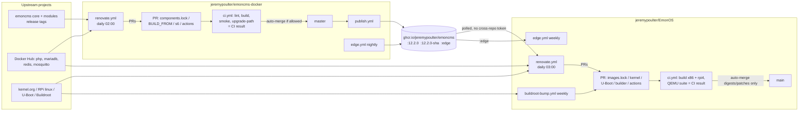

# EmonOS dependency management: automated tracking and upgrades

> **Status (2026-11-08):** proposed, not started. Each work package is tracked
> in the release plan as N30–N43 (see Appendix F for the mapping, review notes
> and open questions Q20–Q27). This file is the implementation plan. The
> operator runbook that WP7 produces will be `Docs/dependency-management.md`.

## Steps

- [ ] WP0 — Fix the prerequisites: branch protection, kernel hash checking, fork resync
- [ ] WP1 — One source of truth for the app image set
- [ ] WP2 — Self-hosted Renovate runner and base config, one per repo
- [ ] WP3 — App container images (EmonOS `images.lock`)
- [ ] WP4 — OS dependencies (kernel, U-Boot, RPi firmware, Buildroot)
- [ ] WP5 — Host builder, CI tooling and Python test deps (EmonOS)
- [ ] WP6 — `emoncms-docker` fork: base image, s6, extensions, publishing
- [ ] WP6b — `emoncms-docker` fork: pin emoncms core, modules and EmonScripts; follow emoncms releases
- [ ] WP8 — Branch protection, merge queue (org mode), supporting workflow changes
- [ ] WP9 — Manual and expedited updates (security fixes)
- [ ] WP10 — Tracking development (edge) versions
- [ ] WP7 — Documentation and runbook (last)
- Appendices: A App setup and how it works · B Migration to OEM orgs · C Forking · D Submodules evaluation

---

## 0. Brief for the implementing agent

You are adding automated dependency tracking and upgrade PRs to two GitHub repos:

| Repo | Local path | Role |
|---|---|---|
| `jeremypoulter/EmonOS` | `/home/jpoulter/Dev/JeremyPoulter/EmonOS` | Buildroot OS image (x86-64 VM + Raspberry Pi 4), A/B RAUC updates, preloads the app container set |
| `jeremypoulter/emoncms-docker` | `/home/jpoulter/Dev/JeremyPoulter/emoncms-docker` | Fork that builds the multi-arch `ghcr.io/jeremypoulter/emoncms` web image consumed by EmonOS. `upstream` remote = `emoncms/emoncms-docker` |

The user has already chosen the tooling:

- **Renovate, self-hosted** via a scheduled GitHub Action (not the Mend app), with **a separate runner in each repo** and **one shared GitHub App**, minting tokens scoped to the running repo only. The two repos must stay independent: each has its own workflow, runner config, repo config, post-upgrade scripts and secrets, and neither runner touches the other repo. The only coupling is that EmonOS consumes a published GHCR image, which its own Renovate finds by polling the registry. There is no cross-repo dispatch.
- **Plus scripts** that Renovate runs as `postUpgradeTasks` to regenerate derived files (lock files, hashes), with CI checks that those derived files are consistent.
- **Automerge policy:** digest-only and patch updates may automerge into the integration branch (`main` / `master`) on green CI. Minor/major updates, MariaDB anything, Buildroot, kernel and bootloader updates are **never** automerged. Nothing is ever auto-promoted to a stable/release channel.
- **Scope:** app stack images; GitHub Actions / submodule / pip; Buildroot kernel and U-Boot pins; the `emoncms-docker` fork, **including pinning emoncms core, every module and EmonScripts, and following emoncms releases** (WP6b).

Read before starting: `Docs/emonos-learnings.md` §6.2–6.3 (why Renovate, automerge trap), `Docs/emonos-product-spec.md` APP-2 (digest pinning is mandatory), `Docs/emonos-poc-implementation-plan.md` D1 (pin Buildroot to a tag), D16 (fork build), D23 (MariaDB held at 11.8), R13 (preload risk accepted on the assumption that `main` becomes gated).

Work on feature branches and open PRs; do not push to `main`/`master` directly. Keep changes consistent with the existing style: POSIX `sh` with `set -eu`, shellcheck-clean, actions pinned by full SHA with a `# vX.Y.Z` comment.

Further user requirements:
- **Manual push-through** of updates such as security fixes (WP9).
- **Tracking development versions** (WP10).
- **Branch protection and merge queues** (WP8). Merge queues need an org, see WP8.0.
- **Clean forking:** nothing breaks; a warning links to setup docs (Appendix C).
- **A migration path** to the OpenEnergyMonitor / emoncms orgs (Appendix B).
- **GHCR image public:** already true, keep it so (WP2.1).

The user asked whether submodules would be better for tracking the emoncms repos; the answer is no, see Appendix D.

**Order:** WP0 first in both repos, then WP8.1 and WP8.3 (gates) before any automerge. The two repos then proceed in parallel:
- **Fork:** WP0.3 → WP8 → WP2 (fork runner) → WP6 → WP6b → WP9 → WP10.
- **EmonOS:** WP8 → WP1 → WP2 (EmonOS runner) → WP4 → WP5 → WP3 → WP9 → WP10.

EmonOS's WP3 web-image rule depends on the fork already publishing `:<emoncms version>` tags and the components label (WP6b.3–6b.4). Until it does, keep the web image on its current digest and give it a temporary `ignoreDeps` entry. WP7 comes last.

---

## 1. Current state (verified 2026-11-05, updated 2026-11-07)

### 1.1 EmonOS

- `main` at `d2ba2ed`, clean, in sync with `origin/main`. PoC WP0–WP9 complete.
- **Branch protection: none** (`gh api .../branches/main/protection` → 404). Repo setting `allow_auto_merge` is `false`. Public repo.
- **CI** `.github/workflows/ci.yml`: `lint` job (actionlint, shellcheck, compose validation, py_compile, coverage check) then a `build` matrix (`x86-64-vm` builds + full QEMU test suite including A/B update, rollback and power-cut tests; `rpi4` builds + image checks). Cold build ~94 min per target; ccache/dl caches on GHA. All actions already SHA-pinned. Python pinned `3.14.7`, actionlint `1.7.12`.
- **Host builder** `ci/builder/Dockerfile`: `ubuntu:24.04@sha256:534baea6…` + `ARG UBUNTU_SNAPSHOT=20261001T000000Z` (apt snapshot). README says bump the digest and snapshot together.
- **Buildroot** submodule at `679b9ead` = tag `2026.02.3` (LTS). `2026.02.x` branch head is the same commit; no newer 2026.02 point release yet. Newer non-LTS releases exist (`2026.05.3`, `2026.08.1`).
- **Defconfigs** (`buildroot-external/configs/emonos_{x86_64_vm,rpi4}_defconfig`):
  - x86: `BR2_LINUX_KERNEL_CUSTOM_VERSION_VALUE="6.12.47"` (current 6.12.y upstream is `6.12.115`).
  - rpi4: kernel tarball from `raspberrypi/linux` commit `21b410140c47…` (appears **twice** on one line). `rpi-6.12.y` head is now `2569533d6c33…`.
  - rpi4: `BR2_TARGET_UBOOT_LATEST_VERSION=y` → resolves to `2026.01` from the Buildroot tree, i.e. U-Boot floats with the submodule.
  - Both copy their kernel pins from Buildroot's reference `pc_x86_64_efi_defconfig` / `raspberrypi4_64_defconfig`.
  - Both set `BR2_DOWNLOAD_FORCE_CHECK_HASHES=y` and `BR2_GLOBAL_PATCH_DIR=""`.
- **Runtime** (`buildroot-external/Config.in`, `BR2_EMONOS_RUNTIME`) selects docker-engine, docker-cli, docker-compose, rauc etc. — versions come entirely from the Buildroot tree.
- **App image set** — three hand-maintained copies of the same data:
  1. `buildroot-external/app/images.lock` (custom `key=value` format):
     ```
     web.source=ghcr.io/jeremypoulter/emoncms@sha256:2686f3c0…   # NO tag
     web.local_tag=emonos-preload/web:20260924
     db.source=mariadb:11.8-noble@sha256:79d59758…
     redis.source=redis:8.10-trixie@sha256:718f745d…
     mqtt.source=eclipse-mosquitto:2.0-openssl@sha256:199ea8ef…
     (each with a matching *.local_tag=emonos-preload/<svc>:20260924)
     ```
  2. `buildroot-external/app/docker-compose.yml`: `image: emonos-preload/<svc>:20260924`, `pull_policy: never`.
  3. `tests/test_boot.py` `PRELOAD_IMAGES` dict (lines ~20–42) and an inline compose snippet (~lines 380–397): full source digests and local tags duplicated.
- **How images ship:** `buildroot-external/app/preload-images.sh` (post-build hook) pulls each `source` for the target platform, retags to `local_tag`, `docker save`s into `data.ext4`. `emonos-preload` loads it **once, at first boot**. A RAUC OS update does **not** refresh app images on an already-provisioned device, so an `images.lock` bump only reaches new factory images until an app-update mechanism exists.
- **Drift:** every pinned image tag has moved since pinning (`mariadb:11.8-noble`, `redis:8.10-trixie`, `eclipse-mosquitto:2.0-openssl`, `ghcr.io/jeremypoulter/emoncms:latest`, `ubuntu:24.04` all resolve to new digests today).
- `tests/requirements.txt`: `labgrid==25.0.1`, `pytest==8.4.2`, `pytest-timeout==2.4.0`. No transitive lock, no hashes.
- No Renovate or Dependabot config exists.

### 1.2 Gap found: the kernel source is not hash-checked

With `BR2_GLOBAL_PATCH_DIR=""`, Buildroot looks for `linux.hash` only in `buildroot/linux/` (and `linux/<version>/`). There is **no** entry for `linux-6.12.47.tar.xz` or the RPi commit tarball there (Buildroot's own hashes cover only `6.12.91` in `before-6.17/`). The hashes that do exist live in `buildroot/board/pc/patches/linux/linux.hash` and `buildroot/board/raspberrypi/patches/linux/linux.hash`, which the reference defconfigs reach via `BR2_GLOBAL_PATCH_DIR` — EmonOS did not copy that setting.

`support/download/check-hash` exits **0 with only a WARNING when no hash file exists**, so `FORCE_CHECK_HASHES` gives no protection for the kernel today. Any automated kernel bump must add a hash, and this must be fixed first (WP0.2). U-Boot `2026.01` *is* checked (`buildroot/boot/uboot/uboot.hash`).

### 1.3 emoncms-docker fork

- Local checkout on `master`, clean, matches `origin/master` = `88f1ed2` (PR #3 "Cross-compile PHP extensions and publish amd64/arm64 images").
- **Diverged from upstream:** `origin/master...upstream/master` = 2 ahead / 4 behind. Upstream merged `emoncms/emoncms-docker#59` (`6a04fac`, 2026-10-21): s6-overlay `3.1.6.2 → 3.2.3.2` (**breaking**: bundles move to `/etc/s6-overlay/user-bundles.d`), phpredis pinned to release `6.3.0` (fork pins commit `df4fab2d…` in `ci/build-php-extensions.sh`), mariadb `11.0 → 11.8`, redis `7.0 → 8`, action bumps, and `web/install_redis.sh` (which the fork may no longer use because it cross-compiles extensions).
- **No branch protection** on `master`.
- `web/Dockerfile`: `ARG BUILD_FROM=php:8.4-apache-trixie` (no digest), `S6_OVERLAY_VERSION=3.1.6.2` downloaded with `curl` **without checksum verification**; clones emoncms (branch `stable` from the workflow) plus 7 module repos and EmonScripts **unpinned**.
- `ci/build-php-extensions.sh`: `PHPREDIS_COMMIT=df4fab2d…`, `MOSQUITTO_PHP_COMMIT=426a08af…`.
- `.github/workflows/docker-release.yml`: triggers on push to `master`, `pull_request`, `workflow_dispatch`. Resolves `php:${PHP_VERSION}-apache-trixie` to a digest **at build time** (so the base floats and Renovate cannot see it). Pushes `ghcr.io/jeremypoulter/emoncms:latest` and `:<emoncms version>` (no immutable per-build tag). Actions are **tag-pinned, not SHA-pinned** (`actions/checkout@v7`, `docker/*@v4`/`@v7`, `upload-artifact@v7`, `download-artifact@v8`).
- `docker-compose.yml` (standalone/dev use, not used by EmonOS): `openenergymonitor/emoncms:latest`, `mariadb:11.0`, `redis:7.0`, `eclipse-mosquitto:2.0`.

### 1.4 emoncms components and their releases (verified 2026-11-06)

`web/Dockerfile` (fork and upstream are identical here) clones these with **no pin at all**:

| Component | Repo | Cloned from | Dockerfile line | Latest release tag | `stable` = latest tag? | Default branch = `stable`? |
|---|---|---|---|---|---|---|
| emoncms core | `emoncms/emoncms` | `-b $BRANCH`. Dockerfile default `master`; the workflow passes `stable` | 82 | `12.2.0` (2026-10-21) | yes | yes |
| dashboard | `emoncms/dashboard` | default branch | 83 | `4.2.1` | yes | yes |
| graph | `emoncms/graph` | default branch | 84 | `3.5.0` | yes | yes |
| app | `emoncms/app` | default branch | 85 | `3.8.2` | yes | yes |
| device | `emoncms/device` | default branch | 86 | `2.6.2` | yes | yes |
| sync | `emoncms/sync` | default branch | 87 | `3.6.0` | yes | yes |
| postprocess | `emoncms/postprocess` | default branch | 88 | `2.8.0` | yes | **no**: `master` (`a14d9239`) is ahead of `stable`/`2.8.0` (`81eccb16`), and its `module.json` says unreleased `2.8.1` |
| backup | `emoncms/backup` | default branch | 89 | `2.6.0` | yes | yes |
| EmonScripts | `openenergymonitor/EmonScripts` | default branch | 100 | `2.0.0` (2026-11-04, **major**) | yes | yes |

Facts that shape the design:

- **Release tags are a reliable proxy for OEM "stable".** Every repo's `stable` branch currently points at its latest release tag. EmonScripts' own installer (`install/emonsd.config.ini`) deploys core and modules from `stable`. Tags are plain semver without a `v` prefix (`12.2.0`, `4.2.1`). emoncms core also has legacy `v9.x` tags, so the versioning regex must ignore the `v` prefix and accept only `^\d+\.\d+\.\d+$`.
- **The image ships unreleased postprocess code today**, because modules are cloned from the default branch and postprocess `master` is ahead of its release. Pinning to tags changes this; test it.
- **Each repo carries its own version**: core in `version.json`, modules in `module.json` (`"version": "4.2.1"`). The build can assert that the checked-out tree's declared version matches the pinned tag.
- **Core releases often**: about 30 releases since June 2026, a major (`12.0.0`) on 2026-10-03, and five releases in October alone. Modules release independently of core. OEM publishes no compatibility matrix or release manifest that ties a core version to module versions (`EmonScripts/components_available.json` lists repo URLs only).
- **Core runs schema migrations on start** (`emoncmsdbupdate.php` → `db_schema_setup` in the image). A core upgrade can change the database irreversibly, so rolling the image back does not roll back the schema. That rules out automerging core minor/major upgrades.
- GitHub Releases exist for core and EmonScripts with notes, so Renovate can put the release notes in the PR body.
- The workflow derives the image's version tag from `version.json` on the `stable` branch at build time, not from what was cloned. After pinning, it must come from the pinned core version.

---

## 2. Dependency inventory and policy

| # | Dependency | Location | Current | Mechanism | Automerge |
|---|---|---|---|---|---|
| A1 | web (emoncms fork image) | `images.lock` | GHCR digest `2686f3c0…`, no tag | Renovate regex → docker datasource | digest: yes |
| A2 | MariaDB | `images.lock` | `11.8-noble@…` | Renovate regex | **never** (separate PR, hold `11.8`) |
| A3 | Redis | `images.lock` | `8.10-trixie@…` | Renovate regex | digest/patch: yes; minor/major: no |
| A4 | Mosquitto | `images.lock` | `2.0-openssl@…` | Renovate regex | digest/patch: yes; minor/major: no |
| O1 | Buildroot | submodule | `2026.02.3` | custom scheduled job (tag-following) | never |
| O2 | x86 kernel | x86 defconfig + hash | `6.12.47` | Renovate regex (6.12.y only) + hash task | never |
| O3 | RPi kernel | rpi4 defconfig + hash | commit `21b41014…` | Renovate git-refs on `rpi-6.12.y` + hash task | never |
| O4 | U-Boot | rpi4 defconfig + hash | `LATEST` → `2026.01` | pin `CUSTOM_VERSION`, Renovate regex + hash task | never |
| O5 | Docker, containerd, runc, RAUC, rpi-firmware, GRUB, EDK2… | Buildroot tree | per submodule | ride with O1 (not tracked separately) | n/a |
| B1 | Builder base image | `ci/builder/Dockerfile` | `ubuntu:24.04@…` | Renovate dockerfile manager | no (grouped with B2) |
| B2 | Ubuntu apt snapshot | `ci/builder/Dockerfile` `ARG UBUNTU_SNAPSHOT` | `20261001T000000Z` | custom monthly job or regex + custom datasource | no |
| C1 | GitHub Actions | `.github/workflows/*.yml` (both repos) | SHA-pinned (EmonOS), tag-pinned (fork) | Renovate github-actions | digest/patch/minor: yes |
| C2 | actionlint version, Python version | `ci.yml` | `1.7.12`, `3.14.7` | Renovate regex | patch: yes |
| C3 | Python test deps | `tests/requirements.txt` | 3 exact pins | Renovate pip_requirements | patch: yes |
| F1 | PHP base image | fork `web/Dockerfile` | `php:8.4-apache-trixie`, unpinned | pin digest in Dockerfile; Renovate dockerfile | digest: yes |
| F2 | s6-overlay | fork `web/Dockerfile` | `3.1.6.2` | Renovate regex (github-releases) + checksum | no (3.2 is breaking) |
| F3 | phpredis, Mosquitto-PHP | fork `ci/build-php-extensions.sh` | commits | Renovate regex (github-tags / git-refs) | no |
| F4 | Fork GitHub Actions | fork workflow | tag-pinned | Renovate github-actions, `pinDigests` | digest/patch/minor: yes |
| E1 | emoncms core | fork `web/components.lock` (new) | `stable` branch, unpinned | Renovate regex → `github-tags` (tag + commit) | **never** for minor/major; patch: see WP6b.5 |
| E2 | dashboard, graph, app, device | fork `web/components.lock` | default branch, unpinned | Renovate regex → `github-tags` | patch: yes; minor/major: no |
| E3 | sync, postprocess, backup | fork `web/components.lock` | default branch, unpinned | Renovate regex → `github-tags` | patch: yes; minor/major: no |
| E4 | EmonScripts | fork `web/components.lock` | default branch, unpinned | Renovate regex → `github-tags` | never (2.0.0 is a new major) |

Automerge is only allowed once required status checks exist (WP0.1, WP8). With `platformAutomerge`, Renovate turns on GitHub auto-merge when it opens the PR, and GitHub merges as soon as the branch rules allow. **With no required checks, that is immediately.** Renovate's own fallback automerge does wait for checks, but don't rely on it. The preflight in WP2.5 forces `automerge: false` when the branch is not gated.

---

## 3. WP0 — Prerequisites

**0.1 Gate `main` (EmonOS) and `master` (fork).** The full procedure, with `gh` commands and the workflow changes it needs, is in **WP8**. The user does the admin steps. Two facts drive it:
- **Merge queues are not available on these repos today.** GitHub offers merge queues only in public repos owned by an **organization** (or private repos in Enterprise Cloud orgs). `jeremypoulter` is a **User** account (verified via `gh api users/jeremypoulter`). WP8 gives a ruleset that works now (strict required checks) and the change that adds the merge queue once the repos are in an org (`emoncms` and `openenergymonitor` are both organizations). It also covers creating an org now.
- **EmonOS `main` is currently red.** Run 41717249659 on `d2ba2ed` failed in `Build x86-64-vm and test` → "Test healthy update, autonomous rollback and interrupted install". Fix or explain that failure before checks become required, or every PR, Renovate's included, is blocked.

This also satisfies the condition R13 was accepted under.

**0.2 Make the kernel actually hash-checked.**
- Add `buildroot-external/patches/linux/linux.hash` with both entries (copy the two lines from `buildroot/board/pc/patches/linux/linux.hash` and `buildroot/board/raspberrypi/patches/linux/linux.hash`; one combined file is fine because Buildroot matches by filename).
- Set `BR2_GLOBAL_PATCH_DIR="$(BR2_EXTERNAL_EMONOS_PATH)/patches"` in both defconfigs.
- Confirm in the build log that the kernel tarball now prints `OK (sha256: …)` rather than `WARNING: no hash file`. Add a CI lint step that fails if either defconfig lacks `BR2_GLOBAL_PATCH_DIR`.
- Check nothing else under the new patch dir changes package patching behaviour (it should only contain `.hash` files).

**0.3 Resync the fork with upstream before automating it.**
Merge `upstream/master` into a branch on the fork, resolving: keep the fork's cross-compiled extension flow; adopt upstream's s6-overlay 3.2.3.2 bundle path change; choose phpredis `6.3.0` (tag) in `ci/build-php-extensions.sh`; drop or keep `web/install_redis.sh` depending on whether it is still used. Build both architectures and run EmonOS's x86 suite against the resulting image before EmonOS consumes it. This is a manual, reviewed change, not a Renovate one.

**Acceptance:** protected branches with required checks; kernel downloads hash-verified on both targets; fork `master` contains upstream `#59`.

---

## 4. WP1 — One source of truth for the app image set

Problem: digests and local tags live in three places, and the web image has no tag Renovate can follow.

1. **`images.lock` stays the single source.** Keep the format but make every `source` line `name:tag@sha256:digest`. For the web image, use the **emoncms version tag** the fork publishes (WP6b.4), e.g. `ghcr.io/jeremypoulter/emoncms:12.2.0@sha256:…`. Under that scheme a digest-only change keeps the same emoncms release (base image or module patch rebuild), and a tag change is an emoncms upgrade, which Renovate can treat by semver.
2. **`tests/test_boot.py`**: replace the hard-coded `PRELOAD_IMAGES` dict and the inline compose snippet with values parsed from `buildroot-external/app/images.lock` (use the `repo_root` fixture already available, or a small helper in `tests/common.py`). The test still checks the same behaviour.
3. **Local tag policy.** Today every local tag is `…:20260924`. A digest change without a tag change gives the same local name to different content, which a future app-update path cannot tell apart. Decide one of (default **a**):
   - a. `local_tag` = `emonos-preload/<svc>:<first 12 hex of the source index digest>`, generated by the script.
   - b. Keep a single release-date tag and require the script to bump it whenever any digest changes.
4. **`docker-compose.yml`** keeps `image: emonos-preload/<svc>:<local tag>`. The generator script (WP3) rewrites these lines from `images.lock`, so they cannot drift.
5. **CI check** (lint job): a script `ci/check-images-lock.sh` that fails if (i) any `source` lacks `:tag@sha256:<64 hex>`, (ii) compose `image:` values differ from `local_tag`s, (iii) a floating tag such as `:latest` appears without a digest anywhere under `buildroot-external/app`, (iv) the optional per-arch metadata (WP3.2) does not match the index digest. Offline-safe: (i)–(iii) need no network; (iv) runs only if the metadata exists and may use the network.

**Acceptance:** changing one digest in `images.lock` and running the generator updates compose, and the tests pick it up without edits; the CI check catches a hand-edited mismatch.

---

## 5. WP2 — Self-hosted Renovate runners, one per repo

Each repo has its own runner workflow, config, scripts and credentials. Both runners use **one GitHub App** (user decision). That is the only shared piece, and it is harmless: each workflow mints a token scoped to **its own repo only**, so neither runner can read or write the other repo. Setup and operation are in **Appendix A**.

**2.1 Authentication.**
- Use a GitHub App installation token, never `GITHUB_TOKEN`. PRs and pushes made with `GITHUB_TOKEN` do not trigger workflows, so required checks would never run.
- Each repo needs repo **variable** `RENOVATE_APP_ID` and repo **secret** `RENOVATE_APP_PRIVATE_KEY`. Each is set per repo, never at user level, so the repos stay separable.
- Mint the token with `actions/create-github-app-token` (SHA-pinned): `app-id: ${{ vars.RENOVATE_APP_ID }}`, `private-key: ${{ secrets.RENOVATE_APP_PRIVATE_KEY }}`, `owner: ${{ github.repository_owner }}`, `repositories: ${{ github.event.repository.name }}`. Nothing is hard-coded to `jeremypoulter`, so the same file works in a fork or after a transfer (Appendix C, D).
- The GHCR image `ghcr.io/jeremypoulter/emoncms` is **already public**: an anonymous manifest pull of `:latest` returned 200 on 2026-11-07. EmonOS needs no registry credentials. Keep it public, and add a CI check in the fork's publish job that an anonymous pull succeeds after publishing.

**2.2 Workflow** `.github/workflows/renovate.yml` (same file in both repos):
- Triggers: `schedule` (EmonOS daily `0 3 * * *`; fork daily `0 2 * * *`; the order doesn't matter) and `workflow_dispatch`, with inputs `dryRun` (choice: `""`, `lookup`, `full`), `logLevel`, and `expedite` (boolean, WP9.1).
- `permissions: {}` at top level; jobs ask only for what they need. The App token does the writing.
- `concurrency: { group: renovate, cancel-in-progress: false }`.
- Jobs: `preflight` (2.5), then `renovate` with `if: needs.preflight.outputs.configured == 'true'`.
- The `renovate` job runs `renovatebot/github-action` (SHA-pinned) with `configurationFile: .github/renovate-global.js`, `token: ${{ steps.app-token.outputs.token }}`, a pinned `renovate-version`, and `env-regex: "^(?:RENOVATE_\\w+|LOG_LEVEL|GITHUB_COM_TOKEN|EMON_\\w+)$"`, so the preflight outputs reach the container.
- Tools for the post-upgrade scripts: `git`, `sha256sum`, `gpg`, plus `regctl` or `crane` for EmonOS. The action runs Renovate in a container, so either use the digest-pinned `ghcr.io/renovatebot/renovate:<ver>-full` image with tools installed on demand, or have the scripts download pinned, checksummed tools into the workspace. **Verify** which works with the action version you pin.

**2.3 Global (runner) config** `.github/renovate-global.js`. It's JS so the target repo and the safety override come from the environment, never from hard-coded owner names:
```js
// Global (self-hosted) Renovate config. Repo policy lives in renovate.json5.
const gated = process.env.EMON_BRANCH_GATED === "true";
const expedite = process.env.EMON_EXPEDITE === "true";
module.exports = {
  platform: "github",
  repositories: [process.env.GITHUB_REPOSITORY],   // this repo only, fork-safe
  onboarding: false,
  requireConfig: "required",
  platformCommit: "enabled",       // commits via API, so GitHub signs them as the App
  allowPostUpgradeCommandTemplating: true,
  allowedCommands: [ /* per repo, anchored; see below */ ],
  force: {
    ...(gated ? {} : { automerge: false }),                    // never automerge an ungated branch
    ...(expedite ? { schedule: [], minimumReleaseAge: null } : {}),  // WP9.1
  },
};
```
`allowedCommands`:
- EmonOS: `^ci/renovate/update-images-lock\.sh$`, `^ci/renovate/update-kernel-hash\.sh [0-9.]+$`, `^ci/renovate/update-rpi-kernel-hash\.sh [0-9a-f]{40}$`, `^ci/renovate/update-uboot-hash\.sh [0-9.]+$`.
- Fork: `^ci/renovate/update-s6-checksums\.sh [0-9.]+$`, `^ci/renovate/update-components-lock\.sh$`.

Anchor every pattern and restrict argument characters, so a hostile version string can't inject shell.

**2.4 Repo config** `renovate.json5` (each repo):
- `extends: ["config:best-practices", ":dependencyDashboard", ":semanticCommitsDisabled"]`.
- `timezone: "Europe/London"`, non-security `schedule: ["before 6am on monday"]`.
- EmonOS: every PR costs about 2 × 90 min of CI, so `prConcurrentLimit: 3`, `prHourlyLimit: 2`. Fork: `prConcurrentLimit: 5`.
- `vulnerabilityAlerts: { enabled: true, schedule: ["at any time"], minimumReleaseAge: null, labels: ["security"] }`.
- `platformAutomerge: true`, `automergeType: "pr"`, `rebaseWhen: "auto"`. Renovate rebases its own PRs when they fall behind, which strict required checks (WP8, user-account mode) need.
- `labels: ["dependencies"]`, and `dependencyDashboardLabels: ["dependencies"]`.
- EmonOS: disable the `git-submodules` manager (WP4.4 handles Buildroot).
- Each repo's lint job validates `renovate.json5` with a pinned `renovate-config-validator --strict`. The global JS file gets `node --check`.

**2.5 Preflight job (fork-safe and misconfiguration-safe).** Runs on `ubuntu-24.04` with `permissions: { contents: read }`:
1. **Credentials present?** `vars.RENOVATE_APP_ID != ''` and `secrets.RENOVATE_APP_PRIVATE_KEY != ''`. Secrets can't be used in a job `if`, so pass `HAS_KEY: ${{ secrets.RENOVATE_APP_PRIVATE_KEY != '' }}` through `env` and test it in the step. If either is missing:
   - emit `::warning title=Renovate is not configured for ${{ github.repository }}::Dependency updates are disabled. See <dependency doc>#setup`;
   - write a step summary with the setup checklist (Appendix A, abbreviated) and a link to the doc;
   - `<dependency doc>` is `Docs/dependency-management.md` in EmonOS and `docs/dependency-management.md` in the fork. Build the link as `${{ github.server_url }}/${{ github.repository }}/blob/${{ github.sha }}/<path>`, so a fork links to its own copy;
   - set `configured=false`. **The workflow ends green**, not failed, so forks don't get failure emails.
2. **Branch gated?** `gh api repos/$GITHUB_REPOSITORY/rules/branches/<default branch>` (works with the default `GITHUB_TOKEN`). Set `gated=true` only if the result contains a `required_status_checks` rule *and* a `pull_request` rule. Otherwise warn (`Automerge disabled: <branch> has no required checks. See <dependency doc>#branch-protection`) and pass `EMON_BRANCH_GATED=false`, which makes the global config force `automerge: false`. Renovate still opens PRs.
3. **Repo settings sane?** `gh api repos/$GITHUB_REPOSITORY --jq .allow_auto_merge`. If false, warn and treat the branch as ungated.

**Acceptance:**
- In each repo, a `dryRun=full` dispatch lists only that repo's dependencies.
- Deleting the variable makes the next run end green with the warning and summary.
- Removing the ruleset makes the next run open PRs with automerge off.
- The App token can't read the other repo: `gh api repos/<other>` with that token returns 404.

---

## 6. WP3 — App container images

**3.1 Regex manager for `images.lock`:**
```json5
{
  customType: "regex",
  managerFilePatterns: ["/^buildroot-external/app/images\\.lock$/"],
  matchStrings: [
    "(?<depName>[a-z0-9]+)\\.source=(?<packageName>[^:@\\s]+):(?<currentValue>[^@\\s]+)@(?<currentDigest>sha256:[a-f0-9]{64})"
  ],
  datasourceTemplate: "docker",
  versioningTemplate: "docker",
}
```
(Check the current Renovate option name: `managerFilePatterns` in recent releases, `fileMatch` in older ones. Pin the Renovate version, then use whichever it supports.)

`depName` becomes the service name (`web`, `db` …) and `packageName` the image. Write packageRules against `matchPackageNames`.

**3.2 Post-upgrade task** `ci/renovate/update-images-lock.sh`:
- For each `source`: resolve the index digest (`regctl manifest digest` / `crane digest`) to confirm it, and record per-platform child digests for `linux/amd64` and `linux/arm64`, plus each image-config digest. The implementation plan asks for that provenance (around line 112). Write them as extra keys in `images.lock` (e.g. `db.digest.linux/arm64=sha256:…`, `db.config.linux/arm64=sha256:…`) or a sibling `images.provenance`. `preload-images.sh` must ignore unknown keys; it does today, because it uses `sed -n "s/^$1=//p"` on exact keys.
- Fail if either platform is missing from the index. Both targets need it.
- For the web image, read the component manifest the fork embeds (WP6b.3, an OCI config label) and record it, e.g. `web.emoncms.version=12.2.0`, `web.component.dashboard=4.2.1@5c8b09cb…`. A digest-only PR then shows which emoncms modules changed, so a reviewer, or automerge, isn't merging blind. If the label is missing, fail.
- Regenerate `local_tag` values (WP1.3) and rewrite the compose `image:` lines.
- Idempotent; `set -eu`; shellcheck-clean; no Docker daemon needed.
- Register it with `postUpgradeTasks: { commands: ["ci/renovate/update-images-lock.sh"], fileFilters: ["buildroot-external/app/**"], executionMode: "branch" }`.

**3.3 Package rules:**
```json5
packageRules: [
  { matchFileNames: ["buildroot-external/app/images.lock"], groupName: null,
    labels: ["app-image"], postUpgradeTasks: { /* 3.2 */ } },

  // MariaDB: own PR, never automerge, hold 11.8 (D23; engine bump = its own release)
  { matchPackageNames: ["mariadb"], allowedVersions: "/^11\\.8-noble$/",
    automerge: false, groupName: "mariadb", labels: ["app-image", "database"],
    prBodyNotes: ["MariaDB changes ship as their own release. Run the x86 suite and the Pi bench before merging."] },

  // Redis, Mosquitto: digest/patch automerge; minor/major manual
  { matchPackageNames: ["redis", "eclipse-mosquitto"], matchUpdateTypes: ["digest", "patch", "pin", "pinDigest"],
    automerge: true },
  { matchPackageNames: ["redis", "eclipse-mosquitto"], matchUpdateTypes: ["minor", "major"],
    automerge: false },
  { matchPackageNames: ["redis"], versioning: "regex:^(?<major>\\d+)\\.(?<minor>\\d+)(?:\\.(?<patch>\\d+))?-(?<compatibility>trixie)$" },
  { matchPackageNames: ["eclipse-mosquitto"], versioning: "regex:^(?<major>\\d+)\\.(?<minor>\\d+)(?:\\.(?<patch>\\d+))?-(?<compatibility>openssl)$" },

  // Fork image follows the emoncms version tag (WP6b.4).
  // Digest = same emoncms release rebuilt (base image / module patch): automerge.
  // Tag change = emoncms upgrade, which can migrate the DB schema: manual.
  { matchPackageNames: ["ghcr.io/jeremypoulter/emoncms"], versioning: "docker" },
  { matchPackageNames: ["ghcr.io/jeremypoulter/emoncms"], matchUpdateTypes: ["digest"], automerge: true },
  { matchPackageNames: ["ghcr.io/jeremypoulter/emoncms"], matchUpdateTypes: ["patch", "minor", "major"],
    automerge: false, labels: ["app-image", "emoncms-release"],
    prBodyNotes: ["emoncms upgrade: runs a DB schema migration on first start. Rolling back the image does not roll back the schema."] },
]
```
Group digest-only refreshes of redis, mosquitto and web into one weekly PR ("app image digests") so they cost one CI run. Keep MariaDB out of the group.

**3.4 Note in the PR template / docs:** an `images.lock` change reaches **new factory images only**. Devices already provisioned keep their first-boot images until the app-update mechanism (signed manifest, learnings §7) exists. Do not imply the merge updates the field.

**Acceptance:** dry run proposes digest updates for all four images (they have drifted, see §1.1). A real PR regenerates compose, local tags and per-arch provenance; CI passes; MariaDB is in a separate PR without automerge.

---

## 7. WP4 — OS dependencies

`make savedefconfig` drops comments, so `# renovate:` annotations in defconfigs would be lost. Put all metadata in `renovate.json5` (regex `depNameTemplate` / `datasourceTemplate`), not in the defconfig.

**4.1 x86 kernel (6.12 LTS line):**
- Regex manager on `emonos_x86_64_vm_defconfig`: `BR2_LINUX_KERNEL_CUSTOM_VERSION_VALUE="(?<currentValue>[^"]+)"`, `datasourceTemplate: "git-tags"`, `packageNameTemplate: "https://git.kernel.org/pub/scm/linux/kernel/git/stable/linux.git"`, `extractVersionTemplate: "^v(?<version>.*)$"`, `allowedVersions: "/^6\\.12\\.\\d+$/"`.
- Also update `BR2_PACKAGE_HOST_LINUX_HEADERS_CUSTOM_6_12=y` only if the series changes, which `allowedVersions` prevents.
- Post-upgrade `ci/renovate/update-kernel-hash.sh {{newVersion}}`: fetch `https://cdn.kernel.org/pub/linux/kernel/v6.x/sha256sums.asc`, **verify the GPG signature** (the kernel.org autosigner key, fingerprint stored in the repo), then replace the `linux-<old>.tar.xz` line in `buildroot-external/patches/linux/linux.hash`.
- Never automerge. Label `os`, `kernel`. Weekly at most (6.12.y releases often; consider `schedule: ["on the first day of the month"]` plus security-label overrides).

**4.2 RPi kernel:**
- Regex manager on `emonos_rpi4_defconfig` that captures the first occurrence of the commit as `currentDigest`, `datasourceTemplate: "git-refs"`, `packageNameTemplate: "https://github.com/raspberrypi/linux"`, `currentValueTemplate: "rpi-6.12.y"`.
- **Verify that Renovate replaces both occurrences** of the SHA on that line. If it does not, either (a) have the hash task rewrite the line wholesale, or (b) switch the defconfig to `BR2_LINUX_KERNEL_CUSTOM_REPO_GIT` + `BR2_LINUX_KERNEL_CUSTOM_REPO_VERSION="<sha>"`, so the SHA appears once. (b) changes the download format and hash, so check build time and reproducibility first. Default (a).
- Post-upgrade: download the GitHub tarball for the new SHA and record a "Locally calculated" sha256 in `patches/linux/linux.hash`, the same way Buildroot does. Note in the PR that GitHub archive tarballs are not guaranteed byte-stable.
- Never automerge. Expect a Pi bench run before merging.
- Alternative policy, offered to the user as **Decision D-C**: do not track the RPi kernel independently. Let it ride with Buildroot (follow `buildroot/configs/raspberrypi4_64_defconfig`), which Buildroot has already boot-tested. Default: **track `rpi-6.12.y` monthly**, because the Buildroot reference lags.

**4.3 U-Boot:**
- Replace `BR2_TARGET_UBOOT_LATEST_VERSION=y` with `BR2_TARGET_UBOOT_CUSTOM_VERSION=y` + `BR2_TARGET_UBOOT_CUSTOM_VERSION_VALUE="2026.01"` (no functional change today; run `make savedefconfig` and diff).
- Regex manager, `datasourceTemplate: "git-tags"`, `packageNameTemplate: "https://source.denx.de/u-boot/u-boot.git"` (or the GitHub mirror), `extractVersionTemplate: "^v(?<version>\\d{4}\\.\\d{2}(?:\\.\\d+)?)$"`, which excludes `-rc`.
- Hash: add `buildroot-external/patches/uboot/uboot.hash`. Post-upgrade fetches `u-boot-<ver>.tar.bz2` from `https://ftp.denx.de/pub/u-boot/` and verifies its detached `.sig` (or the signed `sha256sums`) before writing the hash.
- Never automerge. The Pi boot path (A/B boot state, `uboot-squashfs.config` fragment, redundant env) must be re-validated on the bench. Label `bootloader`.

**4.4 Buildroot submodule (D1: tags, not branches):**
- Renovate's `git-submodules` manager follows branch heads, which violates D1. Instead add `.github/workflows/buildroot-bump.yml` (weekly + dispatch). It runs `git ls-remote --tags https://gitlab.com/buildroot.org/buildroot.git 'refs/tags/2026.02.*'`, picks the highest non-rc tag, and if that differs from the submodule's current tag, checks it out in the submodule and opens a PR with `peter-evans/create-pull-request` (SHA-pinned), using the same GitHub App token so CI runs.
- PR body: the Buildroot `CHANGES` diff between tags, plus a generated table of version changes for the runtime-critical packages (docker-engine, docker-cli, docker-compose, containerd, runc, rauc, rpi-firmware, grub2, edk2, systemd, openssl). Read them from `buildroot/package/*/*.mk` at both tags.
- Also report whether Buildroot's reference board kernel pins moved, as a hint for 4.1/4.2.
- Never automerge. A new LTS line (`2027.02`) is a deliberate manual migration. The job must stay within `2026.02.*` and only mention the newer LTS in the PR or issue body.
- Cache keys already include the submodule SHA, so a bump gets a cold build (~94 min/target). That is expected.

**Acceptance:** each of 4.1–4.4 produces a correct dry-run PR. The hash files are updated and signature-checked. A forced build of the PR branch passes the hash check (no `WARNING: no hash file` in the log).

---

## 8. WP5 — Host builder, CI tooling, Python

- **B1/B2 builder image:** let Renovate's dockerfile manager update `ubuntu:24.04@sha256:…`. Track `UBUNTU_SNAPSHOT` with a regex manager plus a custom datasource, or a tiny monthly job that sets it to the first of the current month at `T000000Z`. Group B1 and B2 into one PR (the README says bump them together). Never automerge: the builder affects every artifact. The PR body should note that the image is rebuilt in CI via the `ci/builder/Dockerfile` cache key.
- **C1 Actions:** `config:best-practices` keeps SHA pins and the `# vX` comments. Digest, patch and minor updates automerge. Majors are manual.
- **C2:** regex managers for `version: '1.7.12'` (actionlint, github-releases `rhysd/actionlint`) and `python-version: '3.14.7'` (datasource `github-releases`/`python-version`). Patch updates automerge.
- **C3 pip:** the default `pip_requirements` manager handles `tests/requirements.txt`. Patch updates automerge; minor/major (labgrid especially) are manual. Optional: move to `pip-compile` with `--generate-hashes` (Renovate supports the `pip-compile` manager) for a transitive lock. Offer this to the user, don't force it.

---

## 9. WP6 — emoncms-docker fork

Do this after WP0.3 (resync).

1. **Pin the PHP base in source:** `ARG BUILD_FROM=php:8.4-apache-trixie@sha256:<digest>` in `web/Dockerfile`. In `docker-release.yml`, drop the "Resolve PHP image" lookup and read `BUILD_FROM` from the Dockerfile; `ci/build-extension-artifacts.sh` gets the same pinned value, because the extension ABI must match the exact base. Keep the `workflow_dispatch` `php_version` override only if it is still needed; when it is used, the run should warn that the build is unpinned.
2. **s6-overlay:** verify downloads against the release's `.sha256` files. Store per-arch checksums as ARGs, or fetch and compare the `*.sha256` asset from the same release. Prefer storing them, so a compromised release page can't swap both. A regex manager on `S6_OVERLAY_VERSION` (github-releases `just-containers/s6-overlay`) runs post-upgrade `ci/renovate/update-s6-checksums.sh {{newVersion}}`. Never automerge (3.1 → 3.2 changed the bundle layout).
3. **Extensions:** regex managers for `PHPREDIS_COMMIT` / `MOSQUITTO_PHP_COMMIT`. After WP0.3, phpredis should be a tag (`PHPREDIS_VERSION=6.3.0`, github-tags `phpredis/phpredis`). Mosquitto-PHP stays a commit on `openenergymonitor/Mosquitto-PHP` (git-refs, its default branch). Never automerge, because these are compiled ABI artifacts.
4. **Image tags:** see WP6b.4. The emoncms version tag is the tag EmonOS follows.
5. **Scheduled rebuild:** add `schedule: weekly` to `docker-release.yml`. The rebuild uses the pinned inputs, so it only changes the image when a merged PR changed a pin. Security fixes in the base image arrive as a Renovate PR bumping the `BUILD_FROM` digest; merging that PR (automerge for digest-only) triggers the publish. The weekly run only catches anything that failed to publish. Optional: a Trivy scan of the pushed image, with SARIF uploaded.
6. **Fork `renovate.json5`:** `config:best-practices` (SHA-pins the tag-pinned actions), the dockerfile manager for `BUILD_FROM`, the managers from items 2–3 and from WP6b, and automerge for digest/patch updates of actions and the PHP base digest. Ignore `docker-compose.yml`, `docker-compose.prod.yml` and `docker-compose.override.yml` via `ignorePaths`. They are upstream's standalone stack, not shipped by EmonOS. Track them without automerge only if the user wants them kept current.
7. **Upstream relationship:** these changes are fork-local. Because the runner is independent (WP2), the whole Renovate setup could later be offered to `emoncms/emoncms-docker` as-is. Note in the PR which parts are worth offering.
8. **Add a lint job** to the fork's CI: shellcheck on `ci/` and `web/*.sh`, hadolint on `web/Dockerfile`, actionlint, Renovate config validation, and `ci/check-components-lock.sh` (WP6b). Make it a required check.

**Acceptance:** fork builds both architectures from a fully pinned Dockerfile. A Renovate PR bumping the PHP digest builds green and automerges. After the push to `master`, a new GHCR digest appears and EmonOS Renovate opens or updates its web image PR within one schedule cycle.

---

## 9b. WP6b — Pin emoncms core, modules and EmonScripts; follow emoncms releases

Goal: the web image is built from an exact, reviewable set of emoncms component releases. Renovate proposes each new emoncms release as a PR. The image carries a record of what it contains, and EmonOS can see that record.

**6b.1 Lock file** `web/components.lock` (new, fork). One line per component, whitespace-separated, easy to parse in `sh` and with a Renovate regex:
```
# name         repo                            version  commit (full 40 hex)                      install path
emoncms        emoncms/emoncms                 12.2.0   d631e662b1…                               /var/www/emoncms
dashboard      emoncms/dashboard               4.2.1    5c8b09cbd8…                               /var/www/emoncms/Modules/dashboard
graph          emoncms/graph                   3.5.0    70a249c438…                               /var/www/emoncms/Modules/graph
app            emoncms/app                     3.8.2    326a0d131f…                               /var/www/emoncms/Modules/app
device         emoncms/device                  2.6.2    a72109f866…                               /var/www/emoncms/Modules/device
sync           emoncms/sync                    3.6.0    88dde7f1c8…                               /opt/emoncms/modules/sync
postprocess    emoncms/postprocess             2.8.0    81eccb16e8…                               /opt/emoncms/modules/postprocess
backup         emoncms/backup                  2.6.0    3aad63259e…                               /opt/emoncms/modules/backup
EmonScripts    openenergymonitor/EmonScripts   1.9.8    <commit of tag 1.9.8>                     /opt/openenergymonitor/EmonScripts
```
Fill in the full SHAs with `git ls-remote https://github.com/<repo> refs/tags/<ver>^{}` (fall back to `refs/tags/<ver>` for lightweight tags). The symlinks from `Modules/{sync,postprocess,backup}` to `/opt/emoncms/modules/*` stay in the Dockerfile.

**Initial pins (decision D-H, default):** the latest release of each component (the table in §1.4), **except EmonScripts at `1.9.8`**. That is the last 1.x, and the line the currently published image was built from (Sept 2026). 2.0.0 (released 2026-11-04) then arrives as a normal, reviewed Renovate PR. The pinning PR must list every behaviour change compared with the current image, notably **postprocess moving from untagged `master` to `2.8.0`**. To find what the current image actually contains, run `git -C <path> rev-parse HEAD` inside `ghcr.io/jeremypoulter/emoncms@sha256:2686f3c0…`.

**6b.2 Fetch script** `web/fetch-components.sh`, which the Dockerfile `COPY`s and runs in place of the nine `git clone` lines (82–89, 100):
- For each line: `git init` the path, `git fetch --depth 1 https://github.com/<repo> <commit>`, then `git checkout --detach FETCH_HEAD`.
- Verify `git rev-parse HEAD` equals the pinned commit.
- Verify the declared version matches the pinned version: core `version.json` `.version`, modules `module.json` `.version`, EmonScripts' root `module.json`. Use `php -r` or `python3` to read the JSON; `jq` is not in the image.
- Fail the build on any mismatch.
- Keep the shallow `.git` directories. emoncms's Admin → Components page reads git metadata. Check that page with a detached HEAD; if it needs a branch name, create a local `stable` branch at the pinned commit.
- Remove the `EMONCMS_SRC`/`BRANCH` build args, or keep them only as an explicit "dev build" override that prints a warning and tags the image `dev-*`, never `latest` or a version tag.
- Remove the step in `docker-release.yml` that reads the version from `raw.githubusercontent.com/.../stable/version.json`. The image version now comes from `components.lock`.

**6b.3 Embed the manifest in the image:**
- `COPY components.lock /opt/emoncms/components.lock` (readable at runtime and by EmonOS's own checks).
- OCI labels, set in the workflow from the lock file:
  - `org.opencontainers.image.version=<core version>`
  - `org.opencontainers.image.revision=<fork commit>`
  - `org.opencontainers.image.source=https://github.com/jeremypoulter/emoncms-docker`
  - `org.openenergymonitor.emoncms.components=emoncms=12.2.0@d631e662,dashboard=4.2.1@5c8b09cb,…`

  EmonOS's `update-images-lock.sh` reads the components label (WP3.2), which keeps the repos decoupled.

**6b.4 Image tags (decision D-E, default):**
- `:<core version>`, e.g. `:12.2.0`. Moving: it always points at the newest fork build of that core release, for example after a base-image or module patch rebuild. **EmonOS follows this tag by digest.**
- `:<core version>-<fork short sha>`: immutable, for provenance and rollback.
- `:latest`: convenience only; nothing pins to it.
- PR builds stay unpushed (the current behaviour).

With Renovate's `docker` versioning, the suffixed immutable tags are treated as a different "compatibility" and ignored. EmonOS only moves between plain `X.Y.Z` tags, plus digest refreshes within one. Verify this in a dry run.

**6b.5 Renovate rules (fork `renovate.json5`):**
```json5
customManagers: [{
  customType: "regex",
  managerFilePatterns: ["/^web/components\\.lock$/"],
  matchStrings: [
    "(?m)^(?<depName>[A-Za-z0-9_-]+)\\s+(?<packageName>[\\w.-]+/[\\w.-]+)\\s+(?<currentValue>\\d+\\.\\d+\\.\\d+)\\s+(?<currentDigest>[0-9a-f]{40})\\s"
  ],
  datasourceTemplate: "github-tags",
  versioningTemplate: "semver",          // rejects legacy v9.x tags on emoncms core; confirm
}],
packageRules: [
  { matchFileNames: ["web/components.lock"], minimumReleaseAge: "3 days",
    labels: ["emoncms-component"],
    postUpgradeTasks: { commands: ["ci/renovate/update-components-lock.sh"],
                        fileFilters: ["web/components.lock"], executionMode: "update" } },

  // Core: patch automerges only once the smoke test (6b.6) is a required check.
  // Minor/major: manual, own PR, release notes in the body.
  { matchDepNames: ["emoncms"], matchUpdateTypes: ["patch"], automerge: true, groupName: null },
  { matchDepNames: ["emoncms"], matchUpdateTypes: ["minor", "major"], automerge: false,
    labels: ["emoncms-release"],
    prBodyNotes: ["Core upgrade: emoncmsdbupdate.php migrates the DB schema on first start; this is not reversible by rolling back the image."] },

  // Modules: one weekly grouped PR; patch automerge, minor/major manual.
  { matchDepNames: ["dashboard","graph","app","device","sync","postprocess","backup"],
    groupName: "emoncms modules", schedule: ["before 6am on monday"] },
  { matchDepNames: ["dashboard","graph","app","device","sync","postprocess","backup"],
    matchUpdateTypes: ["patch"], automerge: true },
  { matchDepNames: ["dashboard","graph","app","device","sync","postprocess","backup"],
    matchUpdateTypes: ["minor","major"], automerge: false },

  // EmonScripts: always manual.
  { matchDepNames: ["EmonScripts"], automerge: false },
]
```
Things to verify in the dry run:
- **Renovate updates both the tag and the commit.** `github-tags` returns the tag's commit as the new digest. Confirm annotated tags resolve to the commit, not the tag object. `ci/renovate/update-components-lock.sh` then re-checks each commit with `git ls-remote` and fixes or fails.
- **`minimumReleaseAge` gets a timestamp** from `github-tags`. emoncms often follows a release with fixes within hours or days (12.0.0 → 12.0.1 the same day; 11.19.2 → 11.19.8 in five days), so the age gate cuts churn. If `github-tags` gives no timestamp, use `github-releases` for core and EmonScripts, which publish GitHub Releases. Then the commit comes from the post-upgrade script instead of `currentDigest`.
- **Release notes appear in the PR body** (Renovate reads GitHub Releases from the source repo).

**6b.6 Fork smoke test (required check, prerequisite for any automerge in the fork).**
Today the fork's CI only builds. Add a job that, for `linux/amd64`:
- loads the built image;
- starts it with `mariadb:11.8-noble`, `redis:8.10-trixie` and `eclipse-mosquitto:2.0-openssl`, pinned to the same digests EmonOS ships. Copy them into a fork-local `ci/smoke-images.lock`, kept by the fork's own Renovate, so the repos stay independent;
- waits for `sql_ready` (schema setup runs);
- asserts HTTP 200 on `/`;
- creates a user and an input, posts data, and reads a feed back over the API;
- checks that every component in `/opt/emoncms/components.lock` reports the expected version.

Also run an **upgrade path** test: start the previous published `:<core version>` image on a fresh volume, then the new image on the same volume, and assert schema migration succeeds and data survives. This is the closest the fork can get to testing a field upgrade. arm64: a build-only check is enough, because EmonOS's Pi bench covers runtime.

**6b.7 CI consistency check** `ci/check-components-lock.sh` (lint job):
- format valid, no duplicate names;
- `web/Dockerfile` contains no `git clone` and no other network fetch of emoncms code;
- each commit matches its tag (`git ls-remote`; network allowed in CI);
- versions are plain `X.Y.Z`.

**6b.8 How "following emoncms releases" works end to end:**
1. emoncms publishes a release, e.g. core `12.2.1` or graph `3.5.1`.
2. After `minimumReleaseAge`, the fork's Renovate opens a PR updating `web/components.lock`, with release notes. Patch updates automerge on green build + smoke + upgrade-path tests; minor/major wait for a human.
3. The merge to `master` publishes `:12.2.1` (and the immutable tag) to GHCR.
4. On its own schedule, EmonOS's Renovate opens "Update ghcr.io/jeremypoulter/emoncms to 12.2.1". A core version change is **never automerged in EmonOS**; it runs the full x86 suite and needs the Pi bench. A module-only or base-image rebuild keeps the tag, appears as a digest update, and may automerge. The components diff from WP3.2 shows in the PR so a reviewer can see what changed.
5. The fork's dependency dashboard issue lists every pending or held emoncms release, which gives a standing view of how far the image is behind upstream.

**Decision D-I (default: release tags):** follow each component's **release tags** rather than the head of its `stable` branch. They are identical today (§1.4), but tags are immutable, carry release notes and give Renovate a semver to reason about. If the user would rather match exactly what OEM's EmonScripts deploys (`stable` heads), switch the datasource to `git-refs` with `currentValue: stable`; every change is then a digest update.

**Acceptance:**
- The pinned image builds from `components.lock` alone, and a tampered commit or version fails the build.
- The image carries the label and the file.
- A dry run proposes the expected updates (at least EmonScripts `2.0.0` and anything released since pinning).
- A real patch PR goes green, automerges, publishes `:<version>`, and shows up as an EmonOS PR on the next EmonOS run, with the components diff.

---

## 9c. WP8 — Branch protection, merge queue and supporting workflow changes

**8.0 Mode.** Both repos are owned by the **User** account `jeremypoulter`. GitHub only offers merge queues in public repos owned by an organization. So there are two configurations, and the files below cover both:

| Mode | When | Gate |
|---|---|---|
| **user** (now) | repos under `jeremypoulter` | Ruleset: PR required + **strict** required check (branch must be up to date). Renovate rebases its own PRs (`rebaseWhen: auto`); `gh pr update-branch` for human PRs |
| **org** (later, or now — D-L) | repos in an org (`emoncms`, `openenergymonitor`, or a new personal org) | Same ruleset + `merge_queue` rule; strict off (the queue does the up-to-date test) |

**Decision D-L:** to get merge queues now, create a free organization (e.g. `emonos-dev`) and transfer both repos into it: `gh api -X POST repos/jeremypoulter/<repo>/transfer -f new_owner=<org>`. GitHub keeps redirects, but caches, App installations and repo-level variables need redoing (see Appendix B, which covers the same steps). **Default: stay in user mode now and get merge queues at the OEM migration.** Every file below already carries the `merge_group` trigger, so switching is a ruleset change only.

**8.1 Workflow changes. Merge these before applying any ruleset**, or the required check never reports and every PR is blocked.

EmonOS `.github/workflows/ci.yml`:
- Add `merge_group:` to `on:`. It does nothing until a queue exists.
- Change `cancel-in-progress: true` to `cancel-in-progress: ${{ github.event_name == 'pull_request' }}`. Pushes to `main` and merge-group runs must not cancel each other, since they save caches and produce build evidence.
- Add one aggregator job, which becomes the **only** required check, so check names can change without editing rulesets:
  ```yaml
  ci-result:
    name: CI result
    if: always()
    needs: [lint, build]
    runs-on: ubuntu-24.04
    permissions: {}
    steps:
      - name: Require every job to succeed
        env:
          RESULTS: ${{ toJSON(needs.*.result) }}
        run: |
          echo "$RESULTS"
          echo "$RESULTS" | jq -e 'all(.[]; . == "success")' > /dev/null
  ```
- Optional (D-K): save the ccache and download caches only on `push` to `main`, not on PR or merge-group runs (learnings §6.5: PRs read the cache but never write it).
- Fix the red `main` (WP0.1) first.

Fork `.github/workflows/docker-release.yml`: split it in two.
- `ci.yml`, triggered on `pull_request`, `merge_group` and `push` to the default branch: lint (WP6.8) → extensions (amd64, arm64) → multi-arch build with **no push** → smoke + upgrade-path (WP6b.6) → `CI result` aggregator. Required check: `CI result`.
- `publish.yml`, triggered on `push` to the default branch, `schedule` (weekly) and `workflow_dispatch`: it rebuilds from the pinned inputs, pushes, then checks that an anonymous pull works (WP2.1). Guard: `if: github.ref == format('refs/heads/{0}', github.event.repository.default_branch)`.
- **Fork-safety fixes** to the publish logic:
  - Lowercase the owner for GHCR (`${GITHUB_REPOSITORY_OWNER,,}`); GHCR rejects uppercase names.
  - Always push to GHCR.
  - Push to Docker Hub *in addition*, and only when repo variable `DOCKERHUB_IMAGE` and secrets `DOCKER_USERNAME`/`DOCKER_PASSWORD` are all set.
  - Today the workflow pushes `openenergymonitor/emoncms` (hard-coded) **instead of** GHCR whenever Docker Hub credentials exist. Any fork that sets them would try to push to OEM's image.
- SHA-pin every action (WP6.6).

**8.2 Ruleset files**, committed to each repo as `.github/rulesets/default-branch.json` (user mode) and `.github/rulesets/default-branch.org.json` (org mode), so the protection is reviewable and reproducible:
```json
{
  "name": "default-branch",
  "target": "branch",
  "enforcement": "active",
  "conditions": { "ref_name": { "include": ["~DEFAULT_BRANCH"], "exclude": [] } },
  "bypass_actors": [
    { "actor_id": 5, "actor_type": "RepositoryRole", "bypass_mode": "pull_request" }
  ],
  "rules": [
    { "type": "deletion" },
    { "type": "non_fast_forward" },
    { "type": "required_linear_history" },
    { "type": "pull_request", "parameters": {
        "required_approving_review_count": 0,
        "dismiss_stale_reviews_on_push": false,
        "require_code_owner_review": false,
        "require_last_push_approval": false,
        "required_review_thread_resolution": false,
        "allowed_merge_methods": ["squash"] } },
    { "type": "required_status_checks", "parameters": {
        "strict_required_status_checks_policy": true,
        "do_not_enforce_on_create": false,
        "required_status_checks": [ { "context": "CI result", "integration_id": 15368 } ] } }
  ]
}
```
- `integration_id` 15368 is GitHub Actions (verified from existing check runs in both repos).
- `actor_id` 5 is the repository **admin** role. `bypass_mode: pull_request` lets an admin merge a PR without checks (break-glass, WP9.3) but **never push directly**.
- Approvals stay at 0 because the repo has a single maintainer, who can't approve their own PRs. Revisit at migration (D-N).

Org mode differs in two places: `strict_required_status_checks_policy: false`, plus this rule:
```json
{ "type": "merge_queue", "parameters": {
    "merge_method": "SQUASH",
    "grouping_strategy": "ALLGREEN",
    "max_entries_to_build": 2,
    "min_entries_to_merge": 1,
    "max_entries_to_merge": 3,
    "min_entries_to_merge_wait_minutes": 5,
    "check_response_timeout_minutes": 300 } }
```
- EmonOS: `max_entries_to_build: 2`, because each entry costs two runners for about 95 minutes; `check_response_timeout_minutes: 300`, because the build job timeout is 180 and the matrix is parallel.
- Fork: `max_entries_to_build: 5`, `check_response_timeout_minutes: 90`.

**8.3 Admin script** `ci/admin/apply-repo-settings.sh <owner/repo> [user|org]`, committed to each repo, idempotent, run by the maintainer with their own `gh` login (needs admin). It wraps the commands below. They are also listed here so they can be run by hand:
```sh
R=jeremypoulter/EmonOS        # then repeat with jeremypoulter/emoncms-docker

# Merge settings: squash only, auto-merge on, delete branches, offer "Update branch"
gh repo edit "$R" --enable-auto-merge --delete-branch-on-merge --allow-update-branch \
  --enable-squash-merge --enable-merge-commit=false --enable-rebase-merge=false
gh api -X PATCH "repos/$R" -f squash_merge_commit_title=PR_TITLE -f squash_merge_commit_message=PR_BODY

# Actions: read-only default token; workflows can't approve PRs
gh api -X PUT "repos/$R/actions/permissions/workflow" \
  -f default_workflow_permissions=read -F can_approve_pull_request_reviews=false

# Security: Dependabot alerts on (Renovate reads them); Dependabot PRs off (Renovate opens them)
gh api -X PUT "repos/$R/vulnerability-alerts"
gh api -X DELETE "repos/$R/automated-security-fixes"
gh api -X PATCH "repos/$R" --input - <<'EOF'
{"security_and_analysis":{"secret_scanning":{"status":"enabled"},
 "secret_scanning_push_protection":{"status":"enabled"}}}
EOF

# Labels Renovate and the workflows use
for l in dependencies:0366d6 security:b60205 expedite:d93f0b app-image:5319e7 \
         database:5319e7 os:1d76db kernel:1d76db bootloader:1d76db \
         emoncms-release:0e8a16 emoncms-component:0e8a16 edge:fbca04; do
  gh label create "${l%%:*}" -R "$R" --color "${l##*:}" --force
done

# Ruleset: create, or update the existing one with the same name
id=$(gh api "repos/$R/rulesets" --jq '.[] | select(.name=="default-branch") | .id')
if [ -n "$id" ]; then
  gh api -X PUT  "repos/$R/rulesets/$id" --input .github/rulesets/default-branch.json
else
  gh api -X POST "repos/$R/rulesets"     --input .github/rulesets/default-branch.json
fi

# Verify
gh api "repos/$R/rules/branches/$(gh api "repos/$R" --jq .default_branch)" --jq '.[].type'
gh api "repos/$R" --jq '{allow_auto_merge, delete_branch_on_merge, allow_squash_merge, allow_merge_commit}'
```
The script must not apply the ruleset until it confirms (via `gh api repos/$R/commits/<default>/check-runs`) that a `CI result` check run already exists on the default branch, i.e. 8.1 is merged. Also confirm the exact parameter names against the current REST docs (`allowed_merge_methods` and the `merge_queue` parameters are recent additions). If the API rejects a field, drop it and report it rather than guessing.

**8.4 Order:**
1. Fix `main` CI.
2. Merge 8.1 in each repo.
3. Run 8.3 in user mode.
4. Set the App variable and secret (Appendix A).
5. Merge the WP2 Renovate files.
6. Do a dry run, then a live run.

Automerge turns on automatically once the preflight sees the ruleset.

**Acceptance:**
- A PR can't merge with a red `CI result`.
- Direct pushes to the default branch are rejected.
- An admin can still `gh pr merge --admin` a PR.
- The Renovate preflight reports `gated=true`.

---

## 9d. WP9 — Manual and expedited updates (security fixes)

Normal flow is scheduled, aged and grouped. Security fixes need to bypass the schedule and the release-age gate, and sometimes pin something Renovate wouldn't pick, such as an unreleased fix commit. They **never** bypass CI except through the documented break-glass path.

**9.1 Expedite a Renovate run** (both repos):
```sh
gh workflow run renovate.yml -R jeremypoulter/emoncms-docker -f expedite=true
```
`expedite` sets `EMON_EXPEDITE=true`, which makes the global config force `schedule: []` and `minimumReleaseAge: null` for that run only. Every pending update is raised now. For a single item, tick its checkbox on the **Dependency Dashboard** issue; Renovate acts on it in the next run, and `gh workflow run renovate.yml` starts that run now. GitHub-advisory-backed updates (pip, Actions) already bypass the schedule through `vulnerabilityAlerts`.

**9.2 Pin a specific version: `manual-update.yml`** (`workflow_dispatch`, one per repo, same preflight as WP2.5):
- **Fork inputs:**
  - `component`, a choice: `emoncms`, `dashboard`, `graph`, `app`, `device`, `sync`, `postprocess`, `backup`, `EmonScripts`, `php-base`, `s6-overlay`, `phpredis`, `mosquitto-php`;
  - `ref`: a release tag, or a 40-hex commit for an unreleased fix. For `php-base`, either `refresh`, to re-resolve the pinned tag's current digest, or a tag;
  - `reason` (required free text, e.g. `GHSA-xxxx-xxxx-xxxx`);
  - `automerge` (bool, default `false`).
- **EmonOS inputs:**
  - `target`, a choice: `web`, `db`, `redis`, `mqtt`, `kernel-x86`, `kernel-rpi4`, `uboot`, `buildroot`, `builder`;
  - `ref`: an image tag, `tag@sha256:…`, a kernel version, a commit or a Buildroot tag;
  - `reason`, `automerge`.
- **The job:**
  - mints the App token;
  - runs `ci/update-dependency.sh <name> <ref>`. That script is a dispatcher over the **same** scripts Renovate's post-upgrade tasks use, so the two paths can't drift. It resolves and verifies tag↔commit, checks signatures and recomputes hashes;
  - opens a PR with `peter-evans/create-pull-request` (SHA-pinned) on branch `manual/<name>-<ref>`, labelled `security` and `expedite`, with `reason` and the full before/after in the body;
  - if `automerge` is set and the branch is gated, runs `gh pr merge --auto --squash`.
- **Unreleased fix commits in the fork:**
  - the lock line gets version `dev-<sha7>`. Renovate's regex (`\d+\.\d+\.\d+`) doesn't match it, so Renovate leaves it alone;
  - `ci/check-components-lock.sh` allows `dev-*` only when `web/components.overrides` has a matching entry: `name commit reason expires=YYYY-MM-DD` (D-O: 30 days);
  - CI warns once an entry has expired;
  - the edge drift job (WP10.2) flags an override when a release tag that contains the commit exists, using the GitHub compare API: `status` of `behind` or `identical` from tag to commit. Renovate can't follow `dev-*`, so returning to the release is a `manual-update` run with the tag.

**9.3 Getting a fix through the gates fast:**
- *User mode:* the PR must be up to date with the default branch (`gh pr update-branch <n>`), then wait for `CI result`: about 95 minutes for EmonOS, less for the fork.
- *Org mode:* `gh pr merge <n> --squash --auto`, then **jump to the top** of the queue from the PR page (or the GraphQL `enqueuePullRequest` mutation with `jump: true`). Jumping restarts the in-flight queue builds.
- **Break-glass**, only when CI itself is broken (runner outage, an upstream mirror down) and the fix can't wait: `gh pr merge <n> --squash --admin`. It's allowed by the ruleset's admin `pull_request` bypass. The PR must say why, and a follow-up run of the full CI on the default branch is mandatory. Never use direct pushes; the ruleset blocks them.

**9.4 End-to-end example** (emoncms core security fix released as `12.2.1`):
```sh
gh workflow run manual-update.yml -R jeremypoulter/emoncms-docker \
  -f component=emoncms -f ref=12.2.1 -f reason="GHSA-…" -f automerge=true
# PR → CI result green → merged → publish.yml pushes ghcr.io/jeremypoulter/emoncms:12.2.1
gh workflow run manual-update.yml -R jeremypoulter/EmonOS \
  -f target=web -f ref=12.2.1 -f reason="GHSA-…"
# The script resolves 12.2.1 to its digest and per-arch provenance → PR → full x86 suite → human merge
```
For a base-image CVE: `-f component=php-base -f ref=refresh`. The fork's `manual-update` doesn't publish; publishing happens on merge.

**9.5 Knowing when a fix is needed:**
- GitHub advisories don't cover container images or the emoncms repos. Watch releases and security advisories on the emoncms repos (`gh api -X PUT repos/emoncms/emoncms/subscription -F subscribed=true` subscribes to all activity; selecting "Releases" + "Security alerts" under Watch → Custom in the UI is quieter).
- Optional (recommended): a weekly `scan.yml` in each repo runs Trivy (SHA-pinned action, pinned DB-less version), in the fork against the published image and in EmonOS against every `images.lock` source. It opens or updates a single issue listing HIGH/CRITICAL findings **that have a fix available**, with the `manual-update` command to run. It runs with `GITHUB_TOKEN` (`issues: write`) only, so it works in forks with no setup.
- Reminder in every security PR template: merging updates **factory images only** until the app-update mechanism exists (§12).

**Acceptance:**
- `expedite` raises an aged-out update immediately.
- `manual-update` produces a PR identical to what Renovate would produce for the same version.
- An unreleased-commit pin passes CI with an override entry and fails without one.
- The break-glass path is documented and the ruleset allows it.

---

## 9e. WP10 — Tracking development (edge) versions

Goal: always know how far the pinned set is behind upstream development, and catch breakage from upcoming emoncms changes before they're released. Edge artifacts are **never** referenced by `images.lock`, never tagged `latest` or `X.Y.Z`, and never released.

**10.1 Fork `edge.yml`** (nightly `0 1 * * *` + `workflow_dispatch`; needs only `GITHUB_TOKEN` with `packages: write`, so it works in forks):
- `web/components.edge` lists each component's development branch: `name repo branch`. Today that's `master` for every component. Verify each repo's development branch; they're `master`/`stable` pairs per `module.json` `branches_available`.
- Resolve each head with `git ls-remote`. Generate `components.edge.lock` in the workspace (same format). The version is the declared version at that commit plus `-dev.<sha7>`. `check-components-lock.sh --edge` accepts that.
- Skip if the set is identical to the components label on the current `:edge` image.
- Build with the **pinned** base image, s6 and extensions (only emoncms code floats). The Dockerfile takes `ARG COMPONENTS_LOCK=components.lock`.
- Run the smoke and upgrade-path tests (upgrade path: current `:<pinned version>` → edge).
- Push `ghcr.io/<owner-lowercase>/emoncms:edge` and the immutable `:edge-<YYYYMMDD>-<fork sha7>`. Add `org.openenergymonitor.emoncms.channel=edge` to the labels.
- On failure, open or update one issue, "Edge build failing", labelled `edge`, with the failing step and the component diff from the last good edge.

**10.2 Drift report** (same workflow, always runs, even when the build is skipped):
- Writes a table to the step summary and to a single pinned issue, "Upstream drift", updated in place.
- One row per component: pinned version, latest release, `stable` head, dev head, commits dev-ahead-of-pinned, days since the pinned release.
- Also lists active `components.overrides` entries and whether a release now contains them (WP9.2).
- The same table includes the PHP base (pinned digest vs the tag's current digest), s6-overlay and the extensions.

**10.3 EmonOS `edge.yml`** (weekly, Saturday `0 4 * * 6`, + dispatch; **not** a required check; its own concurrency group):
- Generate `output/edge/images.lock` from the committed lock.
  - `web.source`: the same repository as committed, tag `:edge`, resolved to its digest. The repository is derived from `images.lock`, so a fork of EmonOS follows whatever image its lock points at, with no configuration.
  - Redis and Mosquitto: the newest tag in the same compatibility line (e.g. newest `X.Y-trixie`).
  - MariaDB: **unchanged**, because engine changes are deliberate (D23).
  - `local_tag` values: copied from the committed lock, so the committed compose file still matches.
- Requires one small change: `preload-images.sh` reads `${EMONOS_IMAGES_LOCK:-$external_dir/app/images.lock}`. The default build is unchanged, and CI asserts that release builds never set the variable.
- Build x86 with `EMONOS_VERSION=0.0.0-edge.<date>` and run the main suite (`tests/run.sh x86-64-vm`, without the WP7 update fixtures, to save time).
- On failure, open or update the issue "Edge integration failing" with the failing tests and the edge components list (from the image label).

**10.4 Optional OS canary** (monthly; disabled unless `vars.EMONOS_OS_CANARY == 'true'`; D-M default **off**): build x86 with the newest Buildroot stable (`2026.08.x` today) and the newest 6.12.y kernel, then run the suite. It gives early warning before the next LTS migration. The cost is one cold build (about 95 minutes) a month.

**10.5 Renovate's view:** the Dependency Dashboard shows pending *released* updates. The drift issue shows *unreleased* development. Together they're the standing "how far behind are we" view.

**Acceptance:**
- `:edge` publishes nightly when upstream changes.
- The drift issue is current.
- A deliberately broken edge component (test with a fork of one module) opens the failure issue in both repos.
- No edge reference can reach a release build: CI rejects `EMONOS_IMAGES_LOCK` and `:edge` in committed files.

---

## 10. WP7 — Documentation

Each repo gets its own self-contained `dependency-management.md` (EmonOS `Docs/`, fork `docs/`). Neither may depend on the other's doc. Anchors used by the workflow warnings: `#setup`, `#branch-protection`, `#manual-updates`, `#edge`, `#forks`, `#migration`. Contents:
- the inventory (§2), the automerge rules and why (learnings §6.3);
- App setup (Appendix A.1) and key rotation;
- branch protection and the admin script (WP8), user vs org mode;
- running Renovate (dry run, expedite, the Dashboard);
- manual updates and break-glass (WP9), with copy-paste `gh` commands;
- edge channel and drift issue (WP10);
- forks (Appendix C) and migration (Appendix B);
- EmonOS only: Buildroot LTS migration; hand-bumping a kernel when a script fails; the caveat that `images.lock` reaches factory images only.
- fork only: the `components.lock` format, overrides, image tags.

Also commit `docs/renovate-app.md` (the App definition) in each repo, and `.github/rulesets/*.json`. Update `ci/builder/README.md` "Pins" to mention Renovate.

---

## 11. Decisions (defaults the agent should apply unless the user says otherwise)

| ID | Question | Default |
|---|---|---|
| D-A | Runners and App | **Decided:** one runner per repo, **one shared App**, tokens scoped to the running repo |
| D-B | Buildroot: follow `2026.02.x` branch or tags? | **Tags** via the custom job (D1) |
| D-C | RPi kernel: track `rpi-6.12.y` independently or ride with Buildroot's reference defconfig? | **Track monthly**, never automerge |
| D-D | Local tag scheme | **Short index digest** per image |
| D-E | Fork image tag EmonOS follows | **`:<emoncms core version>` by digest**, plus immutable `:<version>-<sha>` (WP6b.4) |
| D-F | pip transitive lock with hashes | **Offer, don't do** |
| D-G | Pin emoncms core + modules + EmonScripts | **Decided: in scope** (WP6b) |
| D-H | Initial component pins | **Latest release of each, EmonScripts held at `1.9.8`**; 2.0.0 comes as a reviewed PR |
| D-I | Follow release tags or `stable` branch heads | **Release tags** (identical today; immutable, semver, release notes) |
| D-J | Core patch automerge in the fork | **Yes, once the smoke and upgrade-path tests are required checks**; core minor/major and every core version change in EmonOS stay manual |
| D-K | CI cost with merge queue (PR run + queue run) | **Full CI on both** at first; measure, then consider lint + build only on `pull_request` with the full suite in `merge_group` |
| D-L | Get merge queues now by moving the repos to an org | **No: user mode (strict checks) now, merge queue at the OEM migration**; the workflows are ready either way |
| D-M | OS canary (newer Buildroot / kernel) | **Off** (`vars.EMONOS_OS_CANARY`) |
| D-N | Required approvals after migration | OEM's call (Appendix B.2) |
| D-O | Expiry for unreleased-commit overrides | **30 days**, CI warns after |
| D-P | Submodules for emoncms repos | **Decided: no**, lock file (Appendix D) |

The user does these by hand (prepare everything, then hand over the exact commands):
1. Create and install the App (A.1).
2. Set the variables and secrets.
3. Run the admin script (WP8.3) after WP8.1 is merged.
4. Decide D-L.

GHCR visibility is already public.

---

## 12. Out of scope / follow-ups

- **App update mechanism for provisioned devices** (signed manifest, pull-before-stop). Without it, `images.lock` changes don't reach the field. The component manifest from WP6b.3 and the provenance in `images.lock` are the inputs that manifest will need (learnings §7.1).
- Other emoncms modules that EmonScripts installs but the image doesn't (usefulscripts, network, demandshaper, config, setup, wifi). Add them to `components.lock` only if the image starts shipping them.
- Buildroot LTS migration to `2027.02` when it ships. Manual, planned work.
- Buildroot `utils/check-package` and CVE scanning (`make pkg-stats` / `show-info` → CVE report) as a scheduled report. Useful input for prioritising bumps; can be added later.
- Release channel promotion (stable/beta) stays a human, tagged action.

---

## 13. Risks and checks

- **CI cost:** every OS-touching PR triggers two ~90-minute builds plus QEMU tests. Grouping, weekly schedules and `prConcurrentLimit` are required. Watch Actions minutes for the first month.
- **Automerge without gating:** never enable `automerge` before WP0.1 is live. Add a guard in `renovate.json5` comments and in the PR description.
- **Post-upgrade scripts run with write tokens.** Keep `allowedCommands` anchored to the specific scripts. The scripts must not execute content fetched from the network, only hash or verify it.
- **Signature verification:** kernel and U-Boot hash updates must verify upstream signatures. A script that just computes the sha256 of whatever it downloaded turns Renovate into a MITM amplifier. The RPi GitHub tarball is the exception (no upstream signature), so mark it "Locally calculated" and require human review.
- **Docker classic store limitation** (`preload-images.sh` comment): one index digest per platform pull. Keep the script's `docker image rm` before pull.
- **Reproducibility check** (`Verify deterministic image assembly`) must still pass on every Renovate PR. If an update breaks it, treat that as a failure, not a flaky test.
- **Schema migrations are one-way.** An emoncms core upgrade can't be undone by restoring the previous image. Keep core version changes manual in EmonOS. The fork's upgrade-path test (6b.6) catches failed migrations, but not every data-dependent one.
- **Release churn.** emoncms core shipped five releases in October 2026. Without `minimumReleaseAge` and grouping, the fork would open a PR every few days, and each one cascades into an EmonOS PR. Tune the age gate after a month.
- **Module and core compatibility is untested upstream.** OEM publishes no compatibility matrix, so the fork's smoke test plus the EmonOS suite *is* the compatibility check. Keep core and module updates in separate PRs, so a breakage points at one change.
- **Independence has a cost.** EmonOS sees fork changes only when the fork publishes and EmonOS's next scheduled run polls GHCR (up to a day's lag). That is intended. Don't add `repository_dispatch` or cross-repo tokens to shorten it.

## 14. Definition of done

- Renovate runs daily in **each** repo from its own workflow and config, with a clean dependency dashboard in each. Neither repo holds credentials or config for the other.
- Every item in §2 is either tracked by Renovate or a scheduled job, or explicitly listed as riding with Buildroot.
- `images.lock` is the only hand-edited source of image references; compose and tests derive from it; CI enforces it.
- `web/components.lock` is the only source of emoncms code in the image. Each component is pinned to a release tag and commit, both are verified at build time, the result is embedded in the image, and new emoncms releases arrive as Renovate PRs.
- Kernel and U-Boot downloads are hash-verified, and the hashes are maintained by signature-checked scripts.
- Digest and patch updates automerge only through protected branches with required checks. These always need a human: MariaDB, kernel, U-Boot, Buildroot, builder image, s6-overlay, PHP extensions, EmonScripts, emoncms core minor/major in the fork, and any emoncms core version change in EmonOS.
- Both repos are gated by the committed ruleset (user mode) with a single `CI result` required check, and switching to org mode + merge queue is a one-command change.
- `manual-update.yml` and `expedite` work in both repos and reuse the Renovate scripts.
- `:edge` publishes nightly, the drift issue is current, and EmonOS's weekly edge run reports failures.
- A fresh fork of either repo is green with warnings only (Appendix C acceptance test).
- `Docs/dependency-management.md` (EmonOS) and `docs/dependency-management.md` (fork) describe all of this, including migration.

---

## Appendix A — GitHub App setup, and how it all works with the current repos

### A.1 Create the App (one-time, done by the maintainer in the web UI)

App creation has no `gh` command. Commit the settings as `docs/renovate-app.md` in each repo, so the App can be recreated later, for example by an org at migration.

1. Go to <https://github.com/settings/apps/new>.
2. **Name:** `jeremypoulter-renovate` (must be globally unique). **Homepage URL:** `https://github.com/jeremypoulter/EmonOS`.
3. **Webhook:** untick *Active*. The runners poll on a schedule; no webhooks are needed.
4. **Repository permissions:**

   | Permission | Access | Why |
   |---|---|---|
   | Contents | Read & write | branches, commits (`platformCommit`) |
   | Pull requests | Read & write | open, update and auto-merge PRs |
   | Issues | Read & write | Dependency Dashboard |
   | Workflows | Read & write | update action pins in `.github/workflows` |
   | Commit statuses | Read & write | `renovate/stability-days` and artifact statuses |
   | Checks | Read | read CI results |
   | Dependabot alerts | Read | `vulnerabilityAlerts` |
   | Metadata | Read | mandatory |

   No account or organization permissions. **No** Administration permission: the App must not be able to change rulesets.
5. **Where can this App be installed:** *Only on this account*.
6. Create the App, then note the **App ID**. Under *Private keys*, choose **Generate a private key**; it downloads a `.pem` file.
7. **Install App**, then *Only select repositories*: `EmonOS` and `emoncms-docker`.
8. Store the credentials **per repo** and delete the local key:
   ```sh
   APP_ID=<app id>; KEY=~/Downloads/jeremypoulter-renovate.<date>.private-key.pem
   for R in jeremypoulter/EmonOS jeremypoulter/emoncms-docker; do
     gh variable set RENOVATE_APP_ID -R "$R" --body "$APP_ID"
     gh secret   set RENOVATE_APP_PRIVATE_KEY -R "$R" < "$KEY"
   done
   shred -u "$KEY"
   ```
9. Optional `gitAuthor` (only used if `platformCommit` is off): `gh api "users/jeremypoulter-renovate%5Bbot%5D" --jq .id`, then `gitAuthor: "jeremypoulter-renovate[bot] <ID+jeremypoulter-renovate[bot]@users.noreply.github.com>"`.
10. Verify each repo independently:
    ```sh
    gh workflow run renovate.yml -R jeremypoulter/emoncms-docker -f dryRun=full -f logLevel=debug
    gh run watch -R jeremypoulter/emoncms-docker "$(gh run list -R jeremypoulter/emoncms-docker -w renovate.yml -L1 --json databaseId -q '.[0].databaseId')"
    ```
    Then the same for `jeremypoulter/EmonOS`.

**Key rotation** (yearly, or on any suspicion): generate a new key, run step 8 again, then delete the old key in the App settings. **Revoking one repo:** remove it from the App installation, or delete that repo's secret. The other repo is unaffected.

### A.2 How it works



- **The repos never talk to each other.** The fork publishes a public image, and EmonOS's Renovate notices new tags and digests by polling GHCR. Either repo works with the other one deleted.
- **A typical emoncms module patch, e.g. graph `3.5.1`:**
  1. After 3 days, the fork's Renovate opens a PR that bumps `web/components.lock`.
  2. CI builds, smoke-tests and runs the upgrade-path test. It's a patch, so the PR auto-merges.
  3. `publish.yml` pushes a new digest for `:12.2.0`.
  4. EmonOS's Renovate opens "Update ghcr.io/jeremypoulter/emoncms digest". The PR body lists the components that changed, from the image label.
  5. EmonOS runs the full x86 + rpi4 build and the x86 QEMU suite. It's digest-only, so the PR auto-merges.
  6. The next factory image ships it.
- **A core minor release, e.g. `12.3.0`:** the fork PR waits for a human, because the schema migrates. After it merges, the fork publishes `:12.3.0`. EmonOS's PR changes the tag, so it waits for a human and the Pi bench.
- **Security fix:** WP9.
- **Development:** WP10. The nightly `:edge` image and the drift issue track it; EmonOS's weekly edge integration run tests against it.

---

## Appendix B — Migrating to the OpenEnergyMonitor / emoncms organizations

Nothing in the workflows names an owner. Image names come from `github.repository_owner`, credentials from same-named variables and secrets, and doc links from `github.repository`. Migration is configuration only, apart from one deliberate image-name change in EmonOS.

**B.1 Upstream the fork work to `emoncms/emoncms-docker`** (org `emoncms`). Send a series of reviewable PRs, in order:
1. Pinned sources: `components.lock`, the fetch script, the pinned `BUILD_FROM`, s6 checksums.
2. CI split, aggregator, lint, SHA-pinned actions, fork-safe publishing (`DOCKERHUB_IMAGE` variable).
3. Smoke and upgrade-path tests.
4. Renovate files and `manual-update.yml`. These are inert until configured: the preflight just warns.
5. `edge.yml` and the drift report.

Each PR must pass on upstream without any org setup.

**B.2 Org setup** (done by an org owner):
- **App:** create an org-owned App with the same permissions (A.1, under *Organization settings → Developer settings*), e.g. `oem-renovate`. Install it on selected repos only. If EmonOS moves to `openenergymonitor` and the image repo stays in `emoncms`, prefer **one App per org**, so each org owns its own key.
- **Credentials:** store them as org-level, repo-restricted values. The names don't change, so no workflow edits are needed:
  ```sh
  gh variable set RENOVATE_APP_ID --org emoncms --visibility selected --repos emoncms-docker --body <id>
  gh secret   set RENOVATE_APP_PRIVATE_KEY --org emoncms --visibility selected --repos emoncms-docker < key.pem
  gh variable set DOCKERHUB_IMAGE -R emoncms/emoncms-docker --body openenergymonitor/emoncms   # keeps the existing Docker Hub publishing
  ```
- **Rulesets:** `ci/admin/apply-repo-settings.sh emoncms/emoncms-docker org`, which turns on the **merge queue**, available because the owner is an org. Repo-level rulesets work on any plan; org-level rulesets depend on the org's plan, so verify before using them.
- **Reviews (D-N):** OEM may want required approvals ≥ 1. Then Renovate auto-merge can't complete without an approval. Pick one:
  - keep 0 approvals and rely on the merge queue + required checks (suits patch and digest updates);
  - require approvals, and have a maintainer batch-approve Renovate PRs from the Dashboard;
  - require approvals, but leave the queue to do the merging once someone approves.

  Don't add the Renovate App to bypass actors; that would skip checks too.
- **GHCR visibility:** the first push creates `ghcr.io/emoncms/emoncms` as **private** for an org. Make it public in the package settings (UI only; the org must allow public packages), then confirm with an anonymous pull.

**B.3 Move EmonOS to the upstream image.** Add a one-off Renovate replacement rule:
```json5
{ matchPackageNames: ["ghcr.io/jeremypoulter/emoncms"],
  replacementName: "ghcr.io/emoncms/emoncms", replacementVersion: "<first upstream version>" }
```
Or run `manual-update.yml -f target=web -f ref=ghcr.io/emoncms/emoncms:<ver>`; the dispatcher must accept a full image reference. It's a new build, so the digests differ: run the full suite and the Pi bench, and merge by hand. Afterwards, remove the replacement rule and update any image name in the docs.

**B.4 If EmonOS itself moves** (e.g. to `openenergymonitor/EmonOS`):
- `gh api -X POST repos/jeremypoulter/EmonOS/transfer -f new_owner=openenergymonitor`. Redirects keep old URLs working.
- **Redo after transfer:**
  - The personal App installation no longer covers the repo: install the org App and set the org variable and secret.
  - Re-run the settings script in org mode. Check whether the repo-level ruleset survived, and recreate it if not; the script is idempotent.
  - The Actions caches are gone, so expect cold builds (about 95 minutes).
  - Re-check required-check names.
- The `buildroot` submodule URL is unaffected.

**B.5 The personal fork afterwards:**
- Either archive it, or keep it as a staging fork.
- To stop its automation, delete its `RENOVATE_APP_ID` variable. The preflight then warns and no PRs open.
- EmonOS must follow exactly one image name. Two published images are fine, as long as nothing pins the stale one.

---

## Appendix C — Forking cleanly

Requirement: a fresh fork of either repo **must not fail or spam**. Anything that needs setup has to say so with a warning and a link to the docs.

| Area | Behaviour in an unconfigured fork | Required implementation |
|---|---|---|
| GitHub Actions | Disabled until the fork owner enables them (GitHub default for forks); scheduled workflows don't run until then | nothing |
| CI (`ci.yml`) | Runs and passes. EmonOS uses ephemeral dev RAUC keys; the fork builds without pushing | no secrets referenced in CI |
| Renovate (`renovate.yml`, `manual-update.yml`) | Preflight finds no `RENOVATE_APP_ID`/key → `::warning::` + step summary with setup steps + link to the fork's own doc → run ends **green** | WP2.5 |
| Renovate in an ungated fork | PRs open, but `automerge` is forced off, with a warning | WP2.5 step 2 |
| Publish (fork) | Pushes to `ghcr.io/<forkowner-lowercase>/emoncms` with `GITHUB_TOKEN` (`packages: write`). The first push creates a **private** package; the job then warns that EmonOS can't pull it until it's made public. Docker Hub is skipped unless `DOCKERHUB_IMAGE` and secrets are set | WP8.1 fork-safety fixes; anonymous-pull check downgraded to a warning when `github.repository` isn't the canonical repo (`vars.CANONICAL_REPO`, unset → warn) |
| EmonOS fork's app images | Still pulls the upstream public image named in `images.lock` | nothing; to use their own image, the fork edits `images.lock` (or uses `manual-update -f target=web -f ref=<full ref>`) |
| Edge workflows | Fork: publishes its own `:edge`. EmonOS: follows the image repository in its own `images.lock` | WP10 derivation from the lock file |
| Admin script | Works for any `<owner/repo>` the caller administers | WP8.3 takes `owner/repo` as an argument |
| Doc links | Point at the fork's own copy | `${{ github.server_url }}/${{ github.repository }}/blob/${{ github.sha }}/…` |

Every warning uses the same shape: `::warning title=<Feature> not configured::<what is disabled>. Set up: <link>#<anchor>`. Each repo's `dependency-management.md` has a **"Setting up automation in a fork"** section:
1. Enable Actions.
2. Create or install a GitHub App (A.1), with your own name, installed on your fork only.
3. Set `RENOVATE_APP_ID` and `RENOVATE_APP_PRIVATE_KEY`.
4. Run `ci/admin/apply-repo-settings.sh <you>/<repo> user`.
5. Fork only: make your GHCR package public if an EmonOS build will consume it.
6. Run `renovate.yml` with `dryRun=full`.

Also mention the hosted Mend Renovate App as a lighter alternative. **It can't run `postUpgradeTasks`**, so lock and hash regeneration won't happen and CI consistency checks will fail on those PRs. Self-hosted is required for full function.

**Acceptance test (do it once per repo):**
- Fork into a second account or a throwaway org and enable Actions.
- Confirm that CI is green, Renovate and manual-update end green with the warning and summary, publish goes to the fork's namespace (fork repo), and no workflow references `jeremypoulter` at runtime.
- Then configure the App in the throwaway fork and confirm that Renovate opens PRs there and **only** there.

---

## Appendix D — Should the emoncms repos be tracked as git submodules?

**Recommendation: no.** Use `web/components.lock` (WP6b). EmonOS keeps its existing `buildroot` submodule, which suits that case (one large tree, built from a local checkout, updated rarely and deliberately), but submodules don't fit the emoncms components.

| Criterion | Submodules (9 under `web/src/…`) | `components.lock` + fetch script |
|---|---|---|
| Pin precision | Exact commit (gitlink) | Exact commit + tag, both verified at build |
| Following **releases** | Renovate's `git-submodules` manager updates to the **head of a branch**: every change is a "digest" update, with no semver, no patch/minor/major policy and no per-version release age. Tag-following is not its primary model; verify before relying on it | `github-tags` datasource: semver types, `minimumReleaseAge`, release notes, per-component automerge policy |
| Following **dev** heads | Natural (track `master`) | Separate edge lock, generated nightly (WP10) |
| Declared version in the image | Needs an extra file anyway | In the lock; checked against `module.json`/`version.json` |
| Fork / clone friendliness | Every checkout, workflow and contributor needs `--recursive` / `submodules: true`. Forgetting it yields an image with empty module dirs: a silent break | Plain clone works |
| Docker build | Sources come from the build context. That suits offline builds, but makes a large context and couples Docker layer caching to unrelated repo churn | Fetches pinned commits during the build; network needed |
| Upstream merges | `.gitmodules` + gitlink conflicts when syncing with `emoncms/emoncms-docker`, which has no submodules | One text file |
| Local development | Edit the module in place and commit in the submodule | `bin/setup_dev_repositories` already clones the modules for dev mounts; keep that |
| Manual pins / overrides (WP9) | `git -C web/src/x checkout <sha>` + commit | One line + overrides entry, same scripts as Renovate |

If offline, context-based builds become a requirement, for example a hermetic build, keep the lock as the source of truth. Add a CI step that fetches the pinned commits into the build context before `docker build`, rather than switching to submodules.

**Should EmonOS take `emoncms-docker` as a submodule?** No. That would couple the repos, which the independence requirement rules out. The published image digest is the interface between them.

---

## Appendix E — Self-hosted vs Mend-hosted Renovate (verified 2026-11-07)

Sources: docs.renovatebot.com/mend-hosted/overview and /hosted-apps-config (Renovate 44.222.0); docs.github.com Actions billing.

| | Self-hosted (this plan) | Mend Renovate Community Cloud (free) | Community (OSS) Cloud (free, on request) |
|---|---|---|---|
| Renovate cost | $0 (it's the OSS CLI) | $0 | $0; request via a "Mend Hosted Request" discussion; at Mend's discretion; needs an OSI licence |
| Compute for Renovate | GitHub-hosted runner. **Free in public repos**; private: $0.006/min (Linux 2-core), drawn from the $12/month included on Free | Mend's | Mend's |
| Runs | Our cron (daily) + `workflow_dispatch` | Every 4 h, plus **webhooks** (Dashboard ticks and PR checkboxes act within about a minute) | Same |
| Concurrency / resources | Ours (one job per repo) | **1 job per org**, 1 vCPU, 3 GB, 15 GB disk, **30 min timeout** | 2 jobs, 6 GB, 25 GB, 60 min |
| `postUpgradeTasks` (lock/hash regeneration) | Any command we allow | **Only Mend's undocumented allowlist**: our scripts won't run | Same |
| Global config (`force`, `allowedCommands`, env-driven repo list) | Yes: fork/ungated automerge guard, `expedite` | No: repo config only (plus org inherited config) | No |
| Credentials | Our GitHub App + key (rotate yearly) | Mend's App; private registries via the Mend portal | Same |
| Trust | Code we pin; token scoped to one repo | Third-party app with write access to installed repos | Same |
| Renovate version | Pinned by us, bumped by Renovate PRs | Mend-managed; lags hours to about a week; majors held | Same |
| Logs | Actions logs | Mend Developer Portal | Same |
| Merge Confidence | Badges only | Badges | **Workflows included** |
| Forks | Our preflight warns and ends green | Not installed in a fork, so nothing runs (also clean) | Same |
| OEM migration | Org creates its own App + secrets | Org installs the Mend app: lowest admin | Same |

**Money.** Both repos are public, so either option costs **$0**. Renovate is never the cost driver. **The CI that each Renovate PR triggers is**, and that's the same under both options:
- EmonOS: about 2 × 95 runner-minutes per PR run, doubled once a merge queue re-runs it.
- A self-hosted Renovate run: about 3–8 minutes a day per repo.

If a repo ever went private:
- Renovate: about 100–250 min/month, roughly $0.60–1.50/month per repo.
- EmonOS CI: about $1.14 per PR run (190 min × $0.006). At about 20 Renovate PRs a month that's about $23–46/month, which already exceeds the Free plan's $12 included compute regardless of where Renovate runs.

Controls: grouping, schedules, `prConcurrentLimit`, and (D-K) a lighter `pull_request` CI.

**What switching to Mend-hosted changes in this plan:**
1. **Lock and hash regeneration moves out of Renovate.** Make as little as possible derived and committed:
   - generate the compose `image:` lines, local tags and per-arch provenance **at build time** from `images.lock`, so a plain digest bump is all Renovate has to write (WP1/WP3);
   - what must stay committed (kernel/U-Boot/RPi `.hash` lines, s6 checksums, the components-lock commit check) goes in a `renovate-fixup.yml` workflow on `renovate/**` branches. It runs the same scripts and pushes a fixup commit **with our own App token**, so CI re-runs;
   - add the App's bot email to `gitIgnoredAuthors`, so Renovate keeps rebasing those branches.
2. **We still need our own GitHub App.** `manual-update.yml`, `buildroot-bump.yml` and the fixup workflow all open or push PRs that must trigger CI, and `GITHUB_TOKEN` can't. Mend removes the Renovate runner, not the App.
3. **No `force` override**, so:
   - the ungated-automerge guard becomes policy: install Mend only on repos whose ruleset is applied, and keep a CI check that fails Renovate PRs with auto-merge enabled when the branch isn't gated;
   - `expedite` becomes Dashboard checkboxes (instant, thanks to webhooks) or `manual-update.yml`.
4. **Timeout and concurrency:** one 30-minute job per org on the free tier. Fine for these repo sizes; Renovate doesn't clone the `buildroot` submodule by default. Apply for the OSS tier when the repos land in the OEM orgs.

**Recommendation:**
- **Stay self-hosted while the plan relies on `postUpgradeTasks`.** The fixup workflow needed under Mend is roughly as much machinery as the runner it replaces, and it has more moving parts: two bots on one branch.
- **Revisit at the OEM migration:** an org that wants zero key management can install Mend and apply for the OSS tier, provided item 1 has been done by then (build-time derivation).
- Doing item 1 anyway (it's simpler and removes drift) keeps the switch to Mend cheap in either direction. **Add it to WP1 as the default.**

### E.1 Implementation effort (rough, per option)

Most of the plan is the same work either way: WP0, WP1, WP4 regex managers, WP6/6b, WP8, WP9, WP10 and the docs. Only the deltas:

| Item | Self-hosted | Mend-hosted |
|---|---|---|
| Runner workflow + global config + preflight | ~0.5–1 day for the first repo; the second is mostly a copy | none |
| Tools for scripts inside the Renovate container (regctl, gpg) | ~0.5 day, the fiddliest part | n/a |
| Lock/hash regeneration | Wire as `postUpgradeTasks`: small | Fixup workflow on `renovate/**` branches, `gitIgnoredAuthors`, loop prevention, preflight: ~1.5–2 days, plus harder debugging (two bots, logs split between the Mend portal and Actions) |
| Build-time derivation (compose, local tags, provenance) | optional (recommended) | required, ~1 day |
| Ungated-automerge guard | `force` in global config: trivial | CI check instead, ~0.5 day |
| Own GitHub App for manual-update / buildroot-bump | needed (same App) | **still needed** |
| Time to first Renovate PR | ~half a day | minutes |

For this plan's scope, self-hosted is the less total work. Mend only wins for a minimal scope (Actions, Docker digests, pip) with no derived files. `renovate.json5` is portable both ways, so changing later only costs the delta rows above.

### E.2 App private-key rotation

- **Generating a key is manual.** GitHub has no API to create (or list) App private keys; it's done in the App settings page. Deleting the old key is also done there. Keys never expire, so rotation is policy, not forced. **Verify** that this is still true when implementing.
- **Everything around it can be automated:**
  - `ci/admin/rotate-renovate-key.sh <pem>` sets `RENOVATE_APP_PRIVATE_KEY` in each repo that uses the App, sets repo variable `RENOVATE_KEY_ROTATED=YYYY-MM-DD`, runs a `dryRun=lookup` Renovate dispatch in each repo to prove the new key works, then `shred`s the file. The maintainer then deletes the old key in the UI.
  - The preflight (WP2.5) warns when `RENOVATE_KEY_ROTATED` is older than 365 days, or missing, so the reminder shows up in the run summary without a separate workflow.
  - On compromise: delete the key in the UI first (immediate revocation), then generate and distribute a new one.
- Alternatives don't help: fine-grained PATs also need manual renewal (and are tied to a person), and there's no OIDC path to an App installation token. Mend-hosted removes this task for the Renovate runner only. The App used by manual-update and buildroot-bump still needs its key rotated.

---

## Appendix F — Release-plan mapping and review notes (2026-11-08)

### F.1 Release-plan issues

Numbered on from the release gap analysis (N1–N21) and the base OS comparison
(N22–N29). None are created as GitHub issues yet. The order is the plan's WP
order. **By hand** marks steps only the maintainer can do.

| # | Work package | Repo | Depends on | By hand |
|---|---|---|---|---|
| N30 | WP0.1 Get `main` CI green and stable before it becomes a required check | EmonOS | — | — |
| N31 | WP0.2 Hash-check the kernel source (`BR2_GLOBAL_PATCH_DIR` + `linux.hash`) | EmonOS | — | — |
| N32 | WP0.3 Resync the fork with upstream `emoncms/emoncms-docker` (#59: s6-overlay 3.2, phpredis 6.3.0) | emoncms-docker | Q27 (N20) | — |
| N33 | WP1 One source of truth for the app image set (`images.lock` → compose, tests) | EmonOS | N40 in plan order only | — |
| N34 | WP2 Self-hosted Renovate runner, global config and preflight, one per repo | both | N40; fork runner after N32 | Create and install the GitHub App; set `RENOVATE_APP_ID` and `RENOVATE_APP_PRIVATE_KEY` per repo |
| N35 | WP3 App container images in Renovate, `update-images-lock.sh`, per-arch provenance | EmonOS | N33, N34; web image rule needs N39 (6b.3–6b.4) | — |
| N36 | WP4 OS dependencies: x86 kernel, RPi kernel, U-Boot pin, Buildroot tag-bump job | EmonOS | N31, N34; Q25 (base OS decision N29) | — |
| N37 | WP5 Host builder, Actions, actionlint/Python versions, pip deps | EmonOS | N34 | — |
| N38 | WP6 Fork: pin PHP base by digest, s6 checksums, extension pins, weekly rebuild, lint job | emoncms-docker | N32, N34 | — |
| N39 | WP6b Fork: `components.lock` for emoncms core, modules, EmonScripts; embed manifest; follow releases; smoke and upgrade-path tests | emoncms-docker | N38; Q22 | — |
| N40 | WP8 Branch protection: `CI result` aggregator, `merge_group`, rulesets, admin script; fork CI/publish split | both | N30; fork part after N32 | Run `ci/admin/apply-repo-settings.sh` for each repo; decide Q20 |
| N41 | WP9 Manual and expedited updates (`expedite`, `manual-update.yml`, overrides, break-glass, optional Trivy scan) | both | N35, N36, N39 | — |
| N42 | WP10 Edge channel: fork nightly `:edge` + drift issue; EmonOS weekly edge integration; optional OS canary | both | N35, N39 | Set `vars.EMONOS_OS_CANARY` only if wanted |
| N43 | WP7 Documentation and runbook, `docs/renovate-app.md`, committed rulesets | both | all above (stub doc lands with N34) | — |

Relation to existing release-plan items:

- **N16** ("Automate dependency updates (Renovate)") is superseded by N30–N43.
- **N4** ("Pin emoncms core and module versions in the web image") is superseded by N39.
- **N19** (security patch path and CVE triage) keeps the policy, target times
  and advisory template; N41 supplies the tooling.
- **N20** (port `emoncms_mqtt` to php-mqtt, use packaged php-redis) would delete
  the Mosquitto-PHP and phpredis pins that N32 and N38 maintain.
- **N2** (signed update channels and app update) is what gets `images.lock`
  changes to provisioned devices. Until then N35 only changes factory images.
- **N29** (base OS decision) decides whether N36 is worth building (Q25).
- **#11** (release process) and R12 (Pi bench in CI) are where the "Pi bench
  before merge" steps in N35, N36 and N39 would become automated.

### F.2 Review notes

1. **`main` is not just red, it is flaky.** Four of the last five `main` runs
   failed (runs 25, 30, 34 and 38; only 37 passed). PR #2 recorded hosted
   failures from the 300-second first-boot health window. A strict
   required check on a flaky 95-minute job blocks every PR, Renovate's
   included. WP0.1 should require a run of consecutive green builds on `main`
   (for example five) before the ruleset is applied, not one fixed failure.
2. **Strict required checks and a daily Renovate run limit automerge to about
   one EmonOS PR a day.** In user mode every merge makes the other open PRs
   out of date. GitHub auto-merge then waits until the branch is updated.
   Renovate only rebases when it runs (daily at 03:00), and each rebase costs
   another 95-minute CI run. Options: accept it, turn strict off in user mode
   for EmonOS (the digest/patch PRs touch disjoint lines), or get merge queues
   now (D-L). Asked as Q26.
3. **WP4 is Buildroot-specific and the base OS is undecided.** If N29 picks
   Debian/mkosi, the kernel regex managers, hash scripts, U-Boot pin and
   `buildroot-bump.yml` are thrown away. WP0.2 (kernel hash) is cheap and a
   real security fix, so do it now. Defer 4.1–4.4 until N29, or limit WP4 to
   the Buildroot bump job. Asked as Q25.
4. **Ordering conflict in the fork.** WP8.1 (before WP6/6b in the fork order)
   makes the fork's `CI result` aggregate lint (WP6.8) and smoke/upgrade-path
   (WP6b.6), which do not exist yet. Land WP8.1 in the fork with lint + build
   only and add the smoke jobs to the aggregator in WP6b.
5. **Dead setup links until WP7.** The WP2.5 preflight warnings link to
   `Docs/dependency-management.md#setup` and `#branch-protection`, which WP7
   writes last. Ship a stub with those anchors in WP2.
6. **The smoke test cannot load a multi-arch build.** `build-push-action` with
   `platforms: linux/amd64,linux/arm64` and no push cannot `load` into the
   runner's Docker. WP6b.6 needs a separate `linux/amd64` build with
   `load: true` (or an OCI archive) for the smoke job.
7. **`images.lock` is also an on-device file.** `preload-images.sh` copies it
   to `/opt/emonos/images.lock` in the rootfs. The new provenance and
   component keys (WP3.2) and the local-tag change (WP1.3) are therefore part
   of the OS image and the input N2's app-update manifest will read. Treat the
   key format as an interface and document it with N2 in mind.
8. **Small factual fix.** Neither defconfig sets `BR2_GLOBAL_PATCH_DIR` at
   all; §1.1 says both set it to `""`. The effect and the WP0.2 fix are the
   same, but the WP0.2 lint check should test for a non-empty value, not just
   the key.
9. **Docker, containerd, runc and RAUC ride with Buildroot (O5).** Within
   `2026.02.x` they only move when Buildroot ships a point release, and LTS
   point releases do not always take Docker minor bumps. The `buildroot-bump`
   PR table helps, but a Docker CVE may need a manual package bump in
   `buildroot-external` before Buildroot ships one. WP9's `manual-update.yml`
   has no target for that today.
10. **Verified as stated:** no branch protection on either repo; `main` at
    `d2ba2ed`, run 41717249659 failed; RPi kernel SHA appears twice on one
    line; `BR2_TARGET_UBOOT_LATEST_VERSION=y`; three copies of the image set
    (`images.lock`, compose, `tests/test_boot.py`); fork clones nine repos
    unpinned (lines 82–89, 100), takes `BUILD_FROM` without a digest, uses
    tag-pinned actions, and pushes to `openenergymonitor/emoncms` instead of
    GHCR whenever Docker Hub credentials exist.

### F.3 Open questions for the maintainer

- **Q20 (D-L)** Create an organization now to get merge queues, or stay in
  user mode until the OEM migration? Default: user mode.
- **Q21 (D-C)** Track `rpi-6.12.y` monthly, or let the RPi kernel ride with
  Buildroot's reference defconfig? Default: track monthly.
- **Q22 (D-H, D-I)** Initial pins: latest release of each component with
  EmonScripts held at 1.9.8, following release tags rather than `stable`
  heads? Default: yes to both. Note postprocess moves from untagged `master`
  to 2.8.0.
- **Q23 (D-J, D-K)** Automerge emoncms core patch releases in the fork once
  smoke and upgrade-path tests are required? Full CI on both PR and queue
  runs at first? Default: yes to both.
- **Q24** Accept the remaining defaults: D-B tags, D-D digest local tags, D-E
  version tag by digest, D-F offer pip lock only, D-M canary off, D-O 30-day
  overrides? D-N is OEM's call at migration.
- **Q25** Defer WP4.1–4.3 until the base OS decision (N29)? Recommended: yes;
  do WP0.2 and the Buildroot bump job now.
- **Q26** Strict "up to date" check in user mode for EmonOS, accepting about
  one automerged PR a day, or strict off until merge queues exist?
  Recommended: strict off for EmonOS, on for the fork.
- **Q27** Accept ramcq's php-mqtt port (N20) before WP0.3/WP6? If yes, the
  fork resync drops the Mosquitto-PHP pin and WP6.3 shrinks to nothing.
